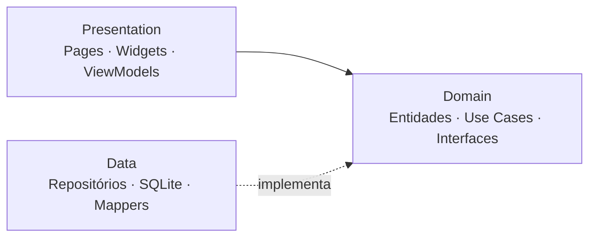

<div align="center">

# 🐾 Mapa do Pet

**Cadastre, localize e acompanhe cães e gatos em situação de rua — direto no mapa.**


*Adote um pet, mude uma vida!*

</div>

---

## 📖 Sobre

Quem cuida de animais de rua costuma guardar tudo de cabeça: onde o bichinho fica, como ele é, quando comeu pela última vez. O **Mapa do Pet** organiza isso. Toque no mapa onde viu o animal, preencha o que souber (só a espécie é obrigatória) e acompanhe o histórico de **alimentação, banho, medicamentos e saúde** — sem apagar nada do que já foi registrado.

> Projeto acadêmico de Desenvolvimento Mobile. Todos os dados ficam **no aparelho**; não há login, servidor nem rastreio da localização de quem usa.

## ✨ Funcionalidades

| | |
|---|---|
| 🗺️ **Mapa interativo** | Alfinetes animados para cães e gatos, filtro por espécie, cartão de resumo flutuante, zoom e "mostrar todos"; cadastro tocando no mapa ou pelo botão **Adicionar animal** (arraste o mapa até o local e confirme) |
| 📝 **Cadastro leve** | Só a espécie é obrigatória; foto, características e saúde são opcionais |
| 📋 **Lista com busca** | Procure por nome ou região, sem diferenciar acentos |
| 🐶 **Perfil completo** | Identificação, características, saúde, vacina antirrábica (Sim/Não/Não sei) |
| 🍽️ **Histórico de cuidados** | Alimentação, banho, medicamentos e saúde — *append-only*, com destaque da última data |
| 🔒 **Privacidade** | Não pede GPS; fotos e dados ficam só no aparelho |
| ℹ️ **Como funciona** | Tela de instruções para novos voluntários |

## 🏗️ Arquitetura em uma imagem



**Clean Architecture enxuta + MVVM**, organizada por funcionalidade. O domínio é Dart puro e nunca conhece Flutter nem SQLite.

### Padrões de projeto aplicados
`Repository` · `MVVM/Observer` · `Dependency Injection` · `Singleton` · `Factory Method` · `Data Mapper` · `Strategy/Specification` · `Facade` · `Value Object` · `Null Object` · `Sealed class (polimorfismo)` · `Use Case` · `Result type`
→ detalhes e código em [docs/04-padroes-de-projeto.md](docs/04-padroes-de-projeto.md).

## 🧰 Stack

| Finalidade | Tecnologia |
|------------|-----------|
| Framework | Flutter · Dart 3 · Material 3 |
| Mapa | `flutter_map` + `latlong2` (tiles OpenStreetMap) |
| Persistência | `sqflite` (SQLite) |
| Estado / DI | `provider` |
| Fotos | `image_picker` · `path_provider` |
| Testes | `flutter_test` · `mocktail` · `sqflite_common_ffi` · `integration_test` |

## 🎨 Identidade visual

| Caramelo | Areia | Branco | Marrom |
|:-:|:-:|:-:|:-:|
|  |  |  |  |
| `#B97942` | `#E7C49F` | `#FFFDF9` | `#49382D` |

## 🚀 Como executar

**Pré-requisitos:** [Flutter SDK](https://docs.flutter.dev/get-started/install) (Dart ≥ 3.0), Android Studio ou Xcode, e um emulador/aparelho.

```bash
# 1. Clonar
git clone <url-do-repositorio>
cd mapa_do_pet

# 2. Gerar as pastas de plataforma (android/ ios/) na primeira vez
flutter create --platforms=android,ios --org br.edu.mapadopet --project-name mapa_do_pet .

# 3. Dependências
flutter pub get

# 4. Rodar
flutter run
```

> Na etapa 2, se o Flutter perguntar sobre arquivos existentes, **mantenha** `lib/`, `pubspec.yaml` e `analysis_options.yaml` do repositório e apague o `test/widget_test.dart` de exemplo, caso seja criado.

**Permissões de plataforma** (configurar uma vez):
- Android — `android/app/src/main/AndroidManifest.xml`: `<uses-permission android:name="android.permission.INTERNET"/>` (necessária para baixar o mapa em builds de release).
- iOS — `ios/Runner/Info.plist`: `NSCameraUsageDescription` e `NSPhotoLibraryUsageDescription`.

## 🧪 Testes

```bash
flutter test                  # unitários, dados e widgets
flutter test --coverage       # cobertura (meta ≥ 80 % em domain/data/viewmodels)
flutter analyze               # análise estática
```

## 🗂️ Estrutura

```
lib/
├── core/                 # tema, DI, banco, erros, serviços, widgets comuns
├── features/
│   ├── pets/             # domain · data · presentation
│   ├── care/             # domain · data · presentation
│   ├── map/              # presentation
│   ├── info/             # presentation
│   └── shell/            # navegação inferior
├── app.dart
└── main.dart
docs/                     # documentação e UML
test/                     # espelha lib/
```

## 📚 Documentação

| Documento | Conteúdo |
|-----------|----------|
| [Plano do projeto](docs/plano-do-projeto.md) | Visão, escopo, requisitos, riscos |
| [Requisitos e casos de uso](docs/01-requisitos-e-casos-de-uso.md) | Casos de uso e rastreabilidade |
| [Arquitetura](docs/02-arquitetura.md) | Camadas, DI, estado, erros |
| [Banco de dados](docs/03-banco-de-dados.md) | ER, dicionário, migrações |
| [Padrões de projeto](docs/04-padroes-de-projeto.md) | Padrões com código |
| [Interface e design](docs/05-interface-e-design.md) | Tokens, wireframes, acessibilidade |
| [Testes](docs/06-estrategia-de-testes.md) | Estratégia e casos |
| [Contribuição](docs/07-guia-de-contribuicao.md) | Git, commits, revisão |
| [Plano de desenvolvimento](docs/08-plano-de-desenvolvimento.md) | Backlog por fase |
| [ADRs](docs/09-decisoes-arquitetura-adr.md) | Decisões de arquitetura |
| **UML** | [domínio](docs/uml/classes-dominio.md) · [camadas](docs/uml/classes-camadas.md) · [sequência](docs/uml/sequencia.md) · [atividades/estados](docs/uml/atividades-e-estados.md) · [componentes/pacotes](docs/uml/componentes-e-pacotes.md) |

## 🗺️ Roadmap

- [x] Fase 0 — Planejamento, documentação e esqueleto
- [x] Fase 1 — Domínio e dados de `pets` (TDD)
- [x] Fase 2 — Cadastro e lista
- [x] Fase 3 — Mapa
- [x] Fase 4 — Perfil e edição
- [x] Fase 5 — Cuidados e histórico
- [x] Fase 7 — Redesign (mapa e telas modernos e interativos) e correção do crash do perfil, após rodar o app no emulador
- [ ] Fase 6 — Informações, acessibilidade e entrega *(382 testes, acessibilidade medida e documentação prontos; o app já rodou no emulador; faltam `integration_test` e TalkBack em aparelho, capturas de tela, APK de release e os slides)*

Detalhes em [docs/08-plano-de-desenvolvimento.md](docs/08-plano-de-desenvolvimento.md).

## 🔮 Fora do escopo (por enquanto)
Login · backend e sincronização · escala de voluntários · status de adoção · mapa offline · rastreio da localização do voluntário.

## 👥 Equipe

| Nome | Responsabilidade |
|------|------------------|
| _a definir_ | _a definir_ |

## 🗺️ Créditos
Mapas © [OpenStreetMap](https://www.openstreetmap.org/copyright) contributors.

<div align="center">

**Adote um pet, mude uma vida!** 🐶🐱

</div>
