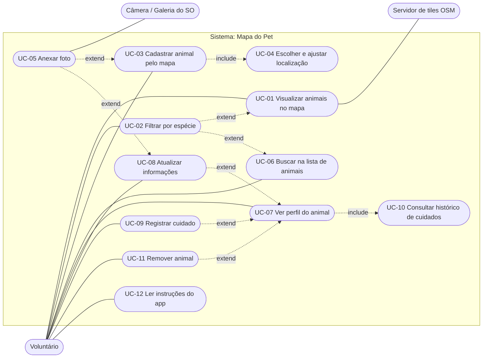

# 01 · Requisitos e casos de uso

> Os requisitos (RF/RNF/RN) estão definidos no [plano do projeto](plano-do-projeto.md#3-requisitos). Este documento os traduz em **casos de uso** e mostra a **rastreabilidade**.

## 1. Atores

| Ator | Tipo | Descrição |
|------|------|-----------|
| **Voluntário** | Primário | Pessoa que encontra ou cuida de um animal de rua. Não há login; qualquer pessoa com o aparelho é "o voluntário". |
| **Servidor de tiles OpenStreetMap** | Secundário (sistema) | Fornece as imagens do mapa. Se estiver inacessível, o mapa fica sem fundo, mas o app continua funcional. |
| **Câmera / Galeria do SO** | Secundário (sistema) | Fornece a foto do animal, sob demanda do voluntário. |

## 2. Diagrama de casos de uso

> Mermaid não tem notação nativa de casos de uso; as elipses são nós arredondados e `include`/`extend` são setas tracejadas rotuladas.

## 3. Catálogo

| UC | Nome | Requisitos | Tela | Fase |
|----|------|-----------|------|------|
| UC-01 | Visualizar animais no mapa | RF-01, RNF-07 | Mapa | 3 |
| UC-02 | Filtrar por espécie | RF-02, RF-08 | Mapa, Animais | 2–3 |
| UC-03 | Cadastrar animal pelo mapa | RF-03, RF-05 | Mapa → Cadastro | 2–3 |
| UC-04 | Escolher e ajustar localização | RF-03, RF-07, RN-04 | Cadastro / Edição | 2–3 |
| UC-05 | Anexar foto | RF-06 | Cadastro / Edição | 2 |
| UC-06 | Buscar na lista de animais | RF-08 | Animais | 2 |
| UC-07 | Ver perfil do animal | RF-04, RF-09, RF-13, RF-14 | Perfil | 4–5 |
| UC-08 | Atualizar informações | RF-10, RF-11 | Edição | 4 |
| UC-09 | Registrar cuidado | RF-12, RN-05…09 | Perfil (sheet) | 5 |
| UC-10 | Consultar histórico de cuidados | RF-13, RF-14 | Perfil | 5 |
| UC-11 | Remover animal | RF-16 | Perfil | 4 |
| UC-12 | Ler instruções do app | RF-15 | Informações | 6 |

## 4. Especificações

### UC-03 · Cadastrar animal pelo mapa

| Campo | Descrição |
|-------|-----------|
| **Ator** | Voluntário |
| **Objetivo** | Registrar um novo cão ou gato no local aproximado onde ele costuma ficar. |
| **Pré-condição** | App aberto na aba Mapa. |
| **Gatilho** | Voluntário toca em uma área livre do mapa. |
| **Pós-condição (sucesso)** | Animal persistido; marcador visível no mapa; animal listado na aba Animais. |
| **Regras** | RN-01, RN-02, RN-03, RN-04, RN-09, RN-13 |

**Fluxo principal**
1. Voluntário toca em um ponto livre do mapa.
2. Sistema exibe a confirmação "Cadastrar animal aqui?".
3. Voluntário confirma.
4. Sistema abre o formulário com as coordenadas do toque preenchidas e um `id` novo já gerado (RN-09).
5. Voluntário escolhe a **espécie** (única obrigatória) e, opcionalmente, preenche os demais campos.
6. Voluntário toca em **Finalizar cadastro**.
7. Sistema valida os dados, desabilita o botão, persiste o animal e exibe confirmação.
8. Sistema retorna ao mapa já com o novo marcador (ou abre o perfil).

**Fluxos alternativos**
- **2a. Voluntário cancela a confirmação:** nada acontece; permanece no mapa.
- **5a. Voluntário quer corrigir o local:** toca no mini-mapa para reposicionar o ponto (UC-04).
- **5b. Voluntário adiciona foto:** executa UC-05 (câmera ou galeria).
- **5c. Sexo = macho:** o campo "Gestante" é ocultado (RN-02).
- **5d. "Possui ninhada" = não/desconhecido:** o campo de quantidade é ocultado (RN-03).
- **6a. Espécie não selecionada:** sistema destaca o campo e informa "Escolha se é cachorro ou gato"; nada é salvo.
- **7a. Toque repetido em "Finalizar":** o botão já está desabilitado e o `id` é o mesmo; nenhum duplicado é criado (RN-09).
- **7b. Falha de gravação:** sistema mantém o formulário preenchido e exibe "Não foi possível salvar. Tente novamente."

### UC-09 · Registrar cuidado

| Campo | Descrição |
|-------|-----------|
| **Ator** | Voluntário |
| **Objetivo** | Registrar uma alimentação, banho, medicamento ou ocorrência de saúde de um animal. |
| **Pré-condição** | Perfil do animal aberto. |
| **Pós-condição (sucesso)** | Novo registro acrescentado ao histórico; registros anteriores intactos; destaques "última alimentação/banho" recalculados. |
| **Regras** | RN-05, RN-06, RN-07, RN-08, RN-09, RN-12 |

**Fluxo principal**
1. Voluntário toca em **Adicionar registro** na seção Cuidados e escolhe o tipo.
2. Sistema abre a folha de registro com data/hora atuais sugeridas e `id` novo.
3. Voluntário ajusta a data (e a hora, se souber), informa o responsável e observações.
4. Voluntário toca em **Salvar**.
5. Sistema valida, persiste (idempotente por `id`) e atualiza o perfil.

**Fluxos alternativos**
- **3a. Medicamento sem nome:** bloqueia e informa "Informe o nome do medicamento" (RN-06).
- **3b. Data no futuro:** bloqueia e informa "A data não pode ser futura" (RN-05).
- **3c. Hora não informada:** registro guarda `hasTime = false` e a UI exibe só a data.
- **3d. Registro retroativo:** aceito; o destaque "última" continua sendo o de maior `occurredAt` (RN-08).

### UC-08 · Atualizar informações

| Campo | Descrição |
|-------|-----------|
| **Pré-condição** | Perfil do animal aberto. |
| **Pós-condição** | Dados gerais do animal alterados e `updatedAt` atualizado; **nenhum** registro de cuidado alterado (RN-07). |

**Fluxo principal:** Voluntário toca em **Atualizar informações** → formulário preenchido com os dados atuais → altera foto, características, localização, antirrábica e saúde → **Salvar** → perfil atualizado.
**Alternativo:** trocar a foto remove o arquivo antigo após o novo ser salvo com sucesso.

### UC-11 · Remover animal

**Fluxo principal:** Perfil → menu **Remover animal** → diálogo "Remover *{nome}* e todo o histórico de cuidados? Esta ação não pode ser desfeita." → **Remover** → sistema apaga o animal, seus registros (cascata) e a foto → retorna à lista.
**Alternativo:** **Cancelar** fecha o diálogo sem alterações.

## 5. Histórias de usuário (visão do voluntário)

| ID | História | UC | Critério resumido |
|----|----------|----|-------------------|
| H-01 | Como voluntário, quero tocar no mapa onde vi um cachorro para registrá-lo em segundos. | UC-03 | Só a espécie é obrigatória. |
| H-02 | Como voluntário, quero ver em um mapa onde estão os animais para saber quem está perto de mim. | UC-01 | Marcadores de cão e gato diferentes. |
| H-03 | Como voluntário, quero saber quando o animal foi alimentado pela última vez para não alimentá-lo em duplicidade. | UC-07, UC-10 | Destaque calculado do registro mais recente. |
| H-04 | Como voluntário, quero registrar um medicamento dado, com quem deu e quando. | UC-09 | Nome obrigatório; histórico preservado. |
| H-05 | Como voluntário, quero corrigir informações quando descobrir mais sobre o animal. | UC-08 | Histórico não é apagado. |
| H-06 | Como voluntário, quero buscar um animal pelo nome ou pela rua. | UC-06 | Busca sem diferenciar acento/maiúscula. |

## 6. Matriz de rastreabilidade

| Requisito | Casos de uso | Fase | Teste principal |
|-----------|--------------|------|-----------------|
| RF-01 | UC-01 | 3 | Widget: mapa renderiza marcadores por espécie |
| RF-02 | UC-02 | 2–3 | Unit: `SpeciesFilter`; Widget: troca de filtro |
| RF-03 | UC-03, UC-04 | 3 | Widget: toque → confirmação → formulário com coordenadas |
| RF-04 | UC-07 | 3 | Widget: toque no marcador abre resumo |
| RF-05 | UC-03 | 1–2 | Unit: `RegisterPet` aceita só espécie; rejeita sem espécie |
| RF-06 | UC-05 | 2 | Unit: `ImageStorageService` (fake); Integração: foto persiste |
| RF-07 | UC-04 | 3 | Widget: reposicionar ponto altera coordenadas salvas |
| RF-08 | UC-06 | 2 | Unit: `TextSearchFilter` (acentos); Widget: lista filtrada |
| RF-09 | UC-07 | 4 | Widget: perfil com dados parciais |
| RF-10 | UC-08 | 4 | Integração de dados: editar pet mantém `care_records` |
| RF-11 | UC-08 | 4 | Unit: 3 estados; padrão `unknown` |
| RF-12 | UC-09 | 5 | Unit: `AddCareRecord`; Dados: append-only |
| RF-13 | UC-07, UC-10 | 5 | Unit: `CareSummary` com registros fora de ordem |
| RF-14 | UC-10 | 5 | Widget: ordem decrescente por tipo |
| RF-15 | UC-12 | 6 | Widget: texto e frase final |
| RF-16 | UC-11 | 4 | Dados: `ON DELETE CASCADE`; Widget: diálogo de confirmação |
