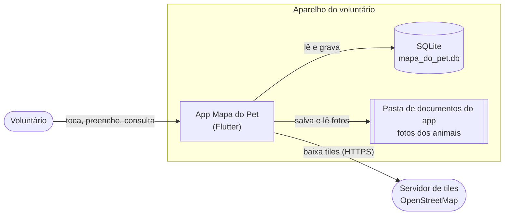
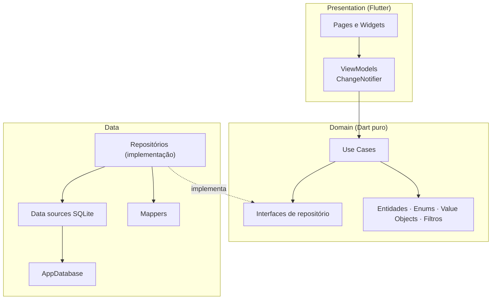
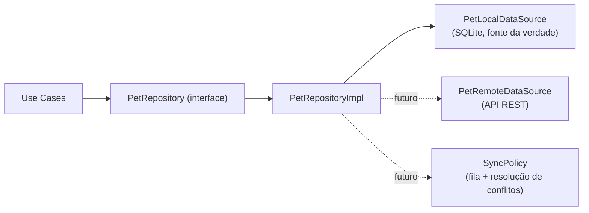

# 02 · Arquitetura

## 1. Contexto do sistema



Tudo roda no aparelho. A **única** dependência de rede é o download de *tiles* do mapa. Não há backend, contas nem sincronização no MVP (ver [plano §1.4](plano-do-projeto.md#14-premissas-do-mvp)).

## 2. Estilo arquitetural

**Clean Architecture enxuta + MVVM**, organizada por **funcionalidade** (*feature-first*) e, dentro de cada uma, por **camada**.



### Regra de dependência
Setas de código apontam **para dentro**: `presentation → domain ← data`. O domínio não importa `package:flutter`, `sqflite` nem `dart:io`. Isso é verificável:

```bash
# deve retornar vazio
grep -rE "package:(flutter|sqflite)|dart:io" lib/features/*/domain lib/core/error
```

### Responsabilidades

| Camada | Responsabilidade | Exemplos | Não pode |
|--------|------------------|----------|----------|
| **Presentation** | Mostrar estado e capturar intenção do usuário | `PetListPage`, `PetFormViewModel` | Acessar SQLite/arquivos; conter regra de negócio |
| **Domain** | Regras de negócio, contratos | `Pet`, `RegisterPet`, `PetRepository` | Conhecer Flutter, SQL ou JSON |
| **Data** | Persistência e integração | `PetRepositoryImpl`, `PetMapper` | Conhecer widgets |
| **Core** | Infraestrutura compartilhada | `Result`, tema, `AppDatabase`, DI | Conhecer features específicas (exceto o DI, que as compõe) |

## 3. Organização de pacotes

```
lib/
├── core/        # transversal: di, database, error, theme, constants, services, utils, widgets
├── features/
│   ├── pets/    # domain · data · presentation
│   ├── care/    # domain · data · presentation
│   ├── map/     # presentation
│   ├── info/    # presentation
│   └── shell/   # presentation (navegação inferior)
├── app.dart
└── main.dart
```

Diagrama de pacotes: [uml/componentes-e-pacotes.md](uml/componentes-e-pacotes.md). Árvore completa de arquivos: [plano §10](plano-do-projeto.md#10-estrutura-de-pastas).

**Dependências entre features:** `map` e `care` dependem de `pets` (entidade `Pet`); `pets` **não** depende de `care`. O perfil (em `pets/presentation`) compõe a seção de cuidados importando apenas o *widget público* de `care` — a única exceção, documentada e deliberada, é o perfil como tela agregadora.

## 4. Composição e injeção de dependências

O **composition root** (`core/di/app_providers.dart`) instancia tudo uma única vez e injeta por construtor.

```dart
// Esboço — lib/core/di/app_providers.dart
List<SingleChildWidget> buildAppProviders({required AppDatabase database}) => [
  // Infra
  Provider<AppDatabase>.value(value: database),
  Provider<ImageStorageService>(create: (_) => ImageStorageService()),

  // Data
  Provider<PetRepository>(
    create: (c) => PetRepositoryImpl(PetLocalDataSource(c.read<AppDatabase>())),
  ),
  Provider<CareRepository>(
    create: (c) => CareRepositoryImpl(CareLocalDataSource(c.read<AppDatabase>())),
  ),

  // Use cases
  Provider(create: (c) => RegisterPet(c.read<PetRepository>())),
  Provider(create: (c) => AddCareRecord(c.read<CareRepository>())),

  // ViewModels
  ChangeNotifierProvider(create: (c) => PetListViewModel(c.read<GetPets>())),
];
```

`main()` abre o banco **antes** de `runApp`, para que falhas de abertura apareçam numa tela de erro controlada e não como tela branca.

```dart
Future<void> main() async {
  WidgetsFlutterBinding.ensureInitialized();
  final database = await AppDatabase.open();
  runApp(MapaDoPetApp(database: database));
}
```

Nos testes, basta passar *fakes* de repositório ao construir os ViewModels — nenhum plugin é necessário.

## 5. Gerenciamento de estado (MVVM)

Cada tela com lógica tem um `ChangeNotifier` (ViewModel) que expõe **estado imutável** e **intenções** (métodos).

```dart
sealed class ViewState<T> { const ViewState(); }
final class Loading<T> extends ViewState<T> { const Loading(); }
final class Empty<T>   extends ViewState<T> { const Empty(); }
final class Loaded<T>  extends ViewState<T> { const Loaded(this.data); final T data; }
final class Failed<T>  extends ViewState<T> { const Failed(this.failure); final Failure failure; }
```

A página usa `switch` exaustivo sobre `ViewState`; o compilador garante que nenhum estado fique sem tela.

| ViewModel | Estado exposto | Intenções |
|-----------|----------------|-----------|
| `MapViewModel` | `ViewState<List<Pet>>`, filtro de espécie | `load`, `setSpecies` |
| `PetListViewModel` | `ViewState<List<Pet>>`, espécie, texto de busca | `load`, `setSpecies`, `setQuery` |
| `PetFormViewModel` | rascunho do `Pet`, `isSaving`, erros por campo | `setSpecies`, `setLocation`, `pickPhoto`, `save` |
| `PetProfileViewModel` | `ViewState<PetProfile>` (pet + `CareSummary`) | `load`, `delete` |
| `CareViewModel` | `isSaving`, erros | `add` |

**Atualização entre telas:** ao salvar um animal/registro, o ViewModel emissor chama `notifyListeners()` e quem exibe listas recarrega ao voltar (`Navigator.pop(result)` + `load()`), mantendo o MVP simples. Evolução possível: repositório expor `Stream<List<Pet>>`.

## 6. Tratamento de erros

Exceções não atravessam camadas. A camada **data** captura e converte para `Result`; os **use cases** devolvem `Result`; os **ViewModels** convertem em estado.

```dart
sealed class Result<T> { const Result(); }
final class Ok<T>  extends Result<T> { const Ok(this.value); final T value; }
final class Err<T> extends Result<T> { const Err(this.failure); final Failure failure; }
```

| `Failure` | Origem típica | Mensagem ao usuário |
|-----------|---------------|---------------------|
| `ValidationFailure(field, message)` | Use case (RN-01…RN-13) | Mensagem do campo |
| `NotFoundFailure` | Repositório (id inexistente) | "Animal não encontrado." |
| `StorageFailure` | Exceção do SQLite | "Não foi possível salvar. Tente novamente." |
| `ImageFailure` | Câmera/galeria/arquivo | "Não foi possível usar essa foto." |

O detalhe técnico (stack trace) é registrado em log; **nunca** exibido ao usuário.

## 7. Navegação

- `HomeShell` com `NavigationBar` + `IndexedStack` (3 abas; preserva estado do mapa).
- Rotas empilhadas via `AppRouter.onGenerateRoute`: `/pet/new` (recebe `LatLng`), `/pet/:id`, `/pet/:id/edit`.
- Fluxo completo de telas: [uml/atividades-e-estados.md](uml/atividades-e-estados.md#3-navegação-entre-telas).

## 8. Aspectos transversais

| Aspecto | Decisão |
|---------|---------|
| **Identificadores** | UUID v4 gerado no cliente (permite idempotência e futura sincronização sem colisão). |
| **Tempo** | Armazenado em UTC (ISO-8601); formatado em `pt_BR` só na UI. Relógio injetável (`typedef Now = DateTime Function()`) para testes determinísticos. |
| **Textos** | Centralizados (`strings`) e extensões `label` por enum na apresentação; domínio sem idioma. |
| **Logs** | `debugPrint` encapsulado em `AppLogger` (sem `print` solto). |
| **Permissões** | Apenas câmera/galeria, sob demanda. Nenhuma de localização. |
| **Segurança** | SQL parametrizado; validação nos use cases; sem segredos no repositório. |

## 9. Caminho de evolução (backend futuro)

A arquitetura foi desenhada para que adicionar sincronização **não altere domínio nem UI**:



Pontos já preparados: IDs UUID, `updated_at` em toda entidade, repositório como única porta de acesso, registros de cuidado *append-only* (fáceis de mesclar).
