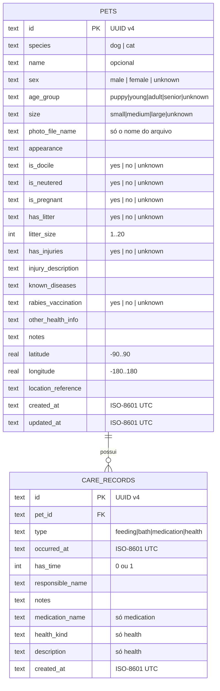

# 03 · Banco de dados

SQLite local via `sqflite`. Arquivo: `mapa_do_pet.db` (diretório de bancos do app). Versão inicial do esquema: **1**.

## 1. Modelo entidade-relacionamento



**Cardinalidade:** um animal tem 0..N registros de cuidado; cada registro pertence a exatamente um animal. A exclusão do animal remove seus registros (`ON DELETE CASCADE`).

## 2. Dicionário de dados

### 2.1 Tabela `pets`

| Coluna | Tipo | Nulo? | Padrão | Regra / observação |
|--------|------|:----:|--------|--------------------|
| `id` | TEXT | não | — | PK. UUID v4 gerado no app ao abrir o formulário (RN-09). |
| `species` | TEXT | não | — | `CHECK IN ('dog','cat')`. **Único campo obrigatório do usuário** (RN-01). |
| `name` | TEXT | sim | — | ≤ 60 caracteres (RN-13). Vazio ⇒ nome de exibição genérico (RN-10). |
| `sex` | TEXT | não | `'unknown'` | `male`, `female`, `unknown`. |
| `age_group` | TEXT | não | `'unknown'` | `puppy`, `young`, `adult`, `senior`, `unknown`. |
| `size` | TEXT | não | `'unknown'` | `small`, `medium`, `large`, `unknown`. |
| `photo_file_name` | TEXT | sim | — | Apenas o **nome** do arquivo; caminho resolvido em execução. |
| `appearance` | TEXT | sim | — | Cor, manchas, pelo, orelhas. ≤ 1000. |
| `is_docile` | TEXT | não | `'unknown'` | `TriState`. |
| `is_neutered` | TEXT | não | `'unknown'` | `TriState`. |
| `is_pregnant` | TEXT | não | `'unknown'` | `TriState`. `yes` inválido se `sex = 'male'` (RN-02, validado no domínio). |
| `has_litter` | TEXT | não | `'unknown'` | `TriState`. |
| `litter_size` | INTEGER | sim | — | 1..20 e só quando `has_litter = 'yes'` (RN-03). |
| `has_injuries` | TEXT | não | `'unknown'` | `TriState`. |
| `injury_description` | TEXT | sim | — | Descrição livre, sem presumir diagnóstico. |
| `known_diseases` | TEXT | sim | — | Texto livre. |
| `rabies_vaccination` | TEXT | não | `'unknown'` | `TriState`. Independente dos registros de saúde (RN-11). |
| `other_health_info` | TEXT | sim | — | Texto livre. |
| `notes` | TEXT | sim | — | Observações gerais. |
| `latitude` | REAL | não | — | `CHECK BETWEEN -90 AND 90` (RN-04). |
| `longitude` | REAL | não | — | `CHECK BETWEEN -180 AND 180` (RN-04). |
| `location_reference` | TEXT | sim | — | "Praça X", "perto da universidade"… Usado na busca por região. |
| `created_at` | TEXT | não | — | ISO-8601 UTC. |
| `updated_at` | TEXT | não | — | ISO-8601 UTC. Atualizado em toda edição. |

### 2.2 Tabela `care_records`

| Coluna | Tipo | Nulo? | Regra / observação |
|--------|------|:----:|--------------------|
| `id` | TEXT | não | PK. UUID gerado ao abrir o formulário; garante idempotência (RN-09). |
| `pet_id` | TEXT | não | FK → `pets(id)` `ON DELETE CASCADE`. |
| `type` | TEXT | não | `feeding`, `bath`, `medication`, `health`. Discriminador do subtipo. |
| `occurred_at` | TEXT | não | **Quando o cuidado aconteceu.** Base de "última alimentação/banho" (RN-08). Não pode ser futuro (RN-05, validado no domínio). |
| `has_time` | INTEGER | não | `0` = só data conhecida; `1` = hora informada. Padrão `0`. |
| `responsible_name` | TEXT | sim | Nome informado de quem cuidou. Único dado pessoal armazenado. |
| `notes` | TEXT | sim | Observação opcional. |
| `medication_name` | TEXT | sim | Obrigatório se `type = 'medication'` (RN-06, também por `CHECK`). |
| `health_kind` | TEXT | sim | Obrigatório se `type = 'health'`: `consultation`, `procedure`, `vaccine`, `injuryTreatment`, `general`. |
| `description` | TEXT | sim | Descrição do atendimento/procedimento; obrigatória (validada no domínio) quando `type = 'health'`. Adicionada pela **migração 002**. |
| `created_at` | TEXT | não | **Quando foi lançado** no app (pode diferir de `occurred_at`). |

> **`occurred_at` × `created_at`:** o primeiro é o fato; o segundo, o lançamento. A tela ordena e destaca por `occurred_at`.

### 2.3 Índices

| Índice | Colunas | Serve a |
|--------|---------|---------|
| `idx_care_pet_type_date` | `(pet_id, type, occurred_at DESC)` | Histórico por tipo e "último registro" sem varrer a tabela. |
| `idx_pets_species` | `(species)` | Filtro Cachorros/Gatos. |

## 3. DDL

O script completo está em [plano §9.2](plano-do-projeto.md#92-esquema) e, no código, em `lib/core/database/migrations/migration_001_initial.dart` (**fonte da verdade**).

## 4. Consultas principais

```sql
-- Lista de animais (mapa e lista)
SELECT * FROM pets ORDER BY created_at DESC;

-- Filtro por espécie
SELECT * FROM pets WHERE species = ? ORDER BY created_at DESC;

-- Histórico de um animal, por tipo, do mais recente para o mais antigo
SELECT * FROM care_records
 WHERE pet_id = ? AND type = ?
 ORDER BY occurred_at DESC;

-- Última alimentação (ou banho) de um animal
SELECT MAX(occurred_at) AS last_at
  FROM care_records
 WHERE pet_id = ? AND type = 'feeding';

-- Inserção idempotente (RN-09): ConflictAlgorithm.ignore ⇒ INSERT OR IGNORE
INSERT OR IGNORE INTO care_records (id, pet_id, type, occurred_at, ...) VALUES (?, ?, ?, ?, ...);
```

Toda consulta usa **parâmetros** (`?`/`whereArgs`), nunca concatenação de texto (prevenção de SQL injection).

> A busca por nome/região **não** é feita em SQL: o `LIKE` do SQLite só ignora maiúsculas para ASCII, falhando em "São"/"sao". Com poucos milhares de linhas locais, a busca roda em Dart sobre texto normalizado (`TextSearchFilter`).

## 5. Migrações

| Versão | Descrição | Arquivo |
|:------:|-----------|---------|
| 1 | Esquema inicial (`pets`, `care_records`, índices) | `migration_001_initial.dart` |
| 2 | Coluna `description` em `care_records` (registro de saúde) | `migration_002_care_description.dart` |

Regras:
1. `AppDatabase.open` usa `version = migrations.length`.
2. `onCreate` executa **todas** as migrações em ordem; `onUpgrade(oldV, newV)` executa as de índice `oldV … newV-1`.
3. **Nunca** editar uma migração já publicada; criar uma nova.
4. `onConfigure` executa `PRAGMA foreign_keys = ON` — sem isso o `CASCADE` **não** funciona no SQLite.
5. Toda migração tem teste: abrir banco na versão N-1, popular, migrar e verificar.

## 6. Arquivos de foto

| Item | Decisão |
|------|---------|
| Local | `<documentos do app>/pet_photos/<uuid>.jpg` |
| No banco | somente `photo_file_name` (`<uuid>.jpg`) |
| Por quê | No iOS o caminho absoluto do container muda entre atualizações; só o nome é estável. |
| Limpeza | Ao trocar a foto, apagar a antiga **depois** de gravar a nova; ao remover o animal, apagar o arquivo. |
| Tamanho | Reduzir na captura (`maxWidth`/`imageQuality` do `image_picker`) para poupar espaço. |

## 7. Backup e privacidade

- Os dados ficam só no aparelho; desinstalar o app os apaga.
- A localização dos animais é aproximada. Qualquer exportação/compartilhamento futuro deve ser **opt-in**.
- Nenhum dado pessoal além do `responsible_name` opcional.
