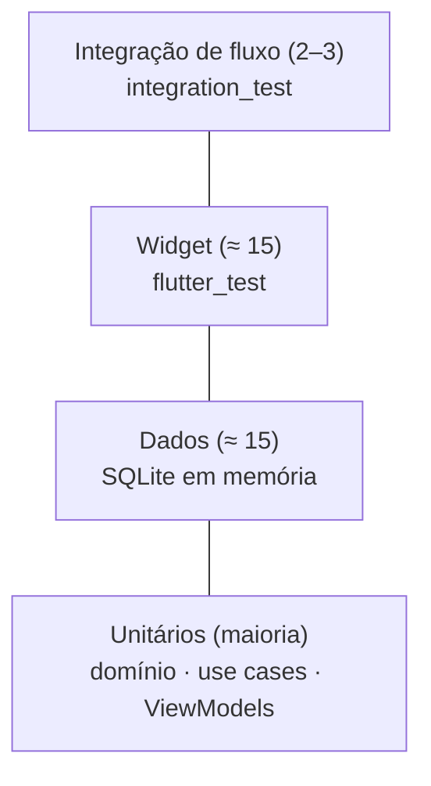

# 06 · Estratégia de testes

## 1. Princípios
- **TDD:** teste falhando (RED) → implementação mínima (GREEN) → refatorar.
- Regras de negócio são testadas **sem Flutter e sem banco** (Dart puro + fakes).
- Cada requisito (RF/RN) tem pelo menos um teste nomeado pelo comportamento.
- Meta: **≥ 80 %** de cobertura em `domain`, `data` e `viewmodels`.

## 2. Pirâmide



| Nível | Alvo | Ferramentas | Roda em |
|-------|------|-------------|---------|
| Unitário | Entidades, enums, filtros, validações, `CareSummary`, use cases, ViewModels | `flutter_test`, `mocktail` ou fakes manuais | VM de teste (segundos) |
| Dados | Repositórios + DataSources + migrações contra SQLite real em memória | `sqflite_common_ffi` (`inMemoryDatabasePath`) | VM de teste |
| Widget | Formulários, `TriStateSelector`, estados vazio/erro, `PetCard` | `flutter_test` (`pumpWidget`) | VM de teste |
| Integração | Cadastrar → listar → registrar cuidado → reiniciar | `integration_test` | Emulador/aparelho |

## 3. Organização

```
test/
├── core/            # Result, text_normalizer, date_formatter, theme
├── features/
│   ├── pets/
│   │   ├── domain/        # entidades, enums, filtros, usecases
│   │   ├── data/          # mapper, repositório (SQLite em memória)
│   │   └── presentation/  # viewmodels, widgets
│   └── care/ …
├── support/         # fakes, builders (PetBuilder), relógio fixo
integration_test/
└── app_flow_test.dart
```
Nomes: `<classe>_test.dart`. Descrições em frases: *"returns Err when species is missing"*.

## 4. Suportes de teste
- **`PetBuilder`**: cria `Pet` válido com padrões e permite sobrescrever só o que importa.
- **`FakePetRepository` / `FakeCareRepository`**: implementam as interfaces com `Map` em memória.
- **Relógio fixo**: `() => DateTime.utc(2025, 3, 12, 12)` injetado nos use cases.
- **`openTestDatabase()`**: abre SQLite em memória com as migrações reais.

## 5. Casos de teste essenciais (por requisito)

| Req. | Caso (Dado/Quando/Então) | Nível |
|------|---------------------------|-------|
| RN-01 | Dado pet só com espécie, quando `RegisterPet`, então `Ok`. | Unit |
| RN-01 | Dado pet sem espécie (formulário), quando salvar, então erro no campo e nada gravado. | Widget |
| RN-02 | Dado macho com `isPregnant = yes`, então `ValidationFailure`. | Unit |
| RN-03 | Dado `litterSize = 3` e `hasLitter = no`, então `ValidationFailure`; `litterSize = 21` também. | Unit |
| RN-04 | Dado latitude 91, então `PetLocation` rejeita. | Unit |
| RN-05 | Dado `occurredAt` amanhã, então `AddCareRecord` retorna `Err`. | Unit |
| RN-06 | Dado medicamento com nome vazio, então `Err`. | Unit |
| RN-07 | Dado pet com 3 registros, quando `UpdatePet`, então continuam 3 registros. | Dados |
| RN-08 | Dado alimentações 10/03, 12/03, 11/03 (nessa ordem de lançamento), então `lastFeeding = 12/03`. | Unit |
| RN-08 | Dado nenhuma alimentação, então `lastFeeding = null` (nunca "hoje"). | Unit |
| RN-09 | Dado dois `save()` seguidos, então um único registro no banco. | Unit + Dados |
| RN-10 | Dado nome vazio/espaços, então `displayName = "Cachorro sem nome"`. | Unit |
| RF-08 | Dado pet em "São Paulo", busca "sao paulo" encontra. | Unit |
| RF-11 | Dado novo pet, `rabiesVaccination = unknown`; os 3 valores persistem e voltam iguais. | Unit + Dados |
| RF-16 | Dado pet com registros, quando `DeletePet`, então registros somem (cascata). | Dados |
| RNF-01 | Dado banco reaberto, então dados persistem; migração N-1 → N preserva linhas. | Dados |
| Enums | `fromName('lixo')` → `unknown`, sem lançar exceção. | Unit |

## 6. Fluxo de integração

`app_flow_test.dart`: abre o app → toca no mapa → confirma → escolhe "Gato" → salva → vê marcador → abre perfil → adiciona alimentação → vê "última alimentação" → fecha e reabre o app (novo `AppDatabase.open` no mesmo arquivo) → dados continuam.

## 7. Comandos

```bash
flutter test                         # todos os testes unitários, de dados e de widget
flutter test --coverage              # gera coverage/lcov.info
flutter test integration_test        # fluxo completo (precisa de emulador/aparelho)
flutter analyze                      # análise estática (deve ficar limpa)
dart format --set-exit-if-changed .  # formatação
```

## 8. Critérios de saída de uma fase
Testes da fase verdes · `flutter analyze` sem avisos · cobertura da fase ≥ 80 % nas camadas-alvo · nenhum teste ignorado (`skip`) sem justificativa registrada.

## 9. Estado atual (após a Fase 7)

| Camada | Cobertura | Observação |
|--------|:---------:|------------|
| Domínio + dados | 99,1 % | Inclui migrações, mappers, repositórios e SQLite real em memória |
| ViewModels | 95,2 % | |
| UI (páginas e widgets) | 94,1 % | A folha de cuidados fica em 74 %: os seletores nativos de data/hora não são exercitados |
| **`lib/` inteiro** | **95,2 %** | 382 testes, `flutter analyze` sem avisos |

Além dos testes por camada:

- **Fluxo completo** (`test/integration/app_flow_test.dart`): SQLite real em arquivo, com o app "fechado e reaberto" no meio. Cobre persistência, edição preservando o histórico, remoção em cascata e idempotência.
- **Acessibilidade** (`test/accessibility/`): fonte a 200 %, alvos de toque, rótulos e contraste.
- **Contraste da paleta** (`test/core/theme/contrast_test.dart`), incluindo a areia clara dos cartões.
- **Interações do mapa** (`test/features/map/presentation/map_page_test.dart`, grupo "interações do redesign"): contador, seleção e fechamento do cartão, toque que só fecha o cartão, dica que some ao arrastar, zoom, "mostrar todos", modo "Adicionar animal" (abrir, cancelar, ignorar toque no mapa, confirmar no centro).
- **Composição de dependências** (`test/core/di/app_providers_test.dart`): resolve **todos** os use cases a partir de `buildAppProviders`.

### Lição: o que os testes não pegaram

Ao rodar o app pela primeira vez no emulador, **abrir o perfil de um animal travava** com
`ProviderNotFoundError`: `GetPetProfile` lê o `CareRepository`, que era declarado
**depois** dele na lista de providers (o Provider só enxerga o que vem acima, e a
leitura é preguiçosa). Os 369 testes da época não viam isso porque cada teste montava os
providers à mão, **sem passar pela raiz de DI real**. O teste de composição acima foi
criado como regressão e falhava antes da correção.

Regra para o futuro: todo teste de widget que depende de providers deve poder usar
`buildAppProviders` (com banco em memória) ao menos uma vez, e o app deve ser executado
num emulador antes de cada entrega.

**Não coberto (precisa de aparelho):** `integration_test` em emulador, TalkBack/VoiceOver e o comportamento real do mapa com a rede. O app já foi **executado manualmente** no emulador (Android 36): mapa, cadastro, lista, perfil e modo "Adicionar animal" conferidos visualmente — isso não é teste automatizado.