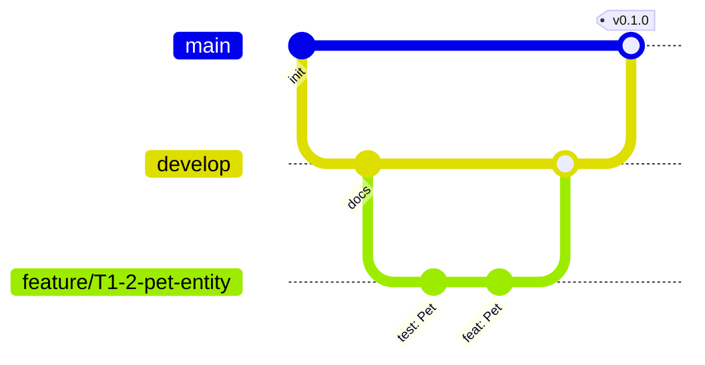

# 07 · Guia de contribuição

## 1. Preparar o ambiente

```bash
flutter --version          # Dart 3.x (sealed classes exigem >= 3.0)
git clone <repositorio> && cd mapa_do_pet
flutter pub get
flutter analyze && flutter test
```

Detalhes de instalação e primeira execução: [README](../README.md#-como-executar).

## 2. Fluxo Git



| Branch | Uso |
|--------|-----|
| `main` | Sempre estável, protegida; recebe merges de `develop` por release/entrega |
| `develop` | Integração contínua do trabalho |
| `feature/T<fase>-<n>-<nome>` | Uma tarefa do [plano de desenvolvimento](08-plano-de-desenvolvimento.md) |
| `fix/<nome>` | Correções |

Nunca commitar direto em `main`. Todo merge em `develop` é via **Pull Request** com 1 aprovação.

## 3. Commits (Conventional Commits)

```
<tipo>(<escopo opcional>): <descrição no imperativo, minúscula>

[corpo opcional: o que e por quê]
```

| Tipo | Quando |
|------|--------|
| `feat` | Funcionalidade nova |
| `fix` | Correção de bug |
| `test` | Só testes |
| `refactor` | Reestruturação sem mudar comportamento |
| `docs` | Documentação |
| `chore` | Dependências, configuração |
| `perf` · `ci` | Desempenho · integração contínua |

Exemplos: `test(care): add CareSummary last feeding cases` · `feat(pets): register pet use case`.
Em TDD, é bem-vindo commitar o `test:` (RED) e depois o `feat:` (GREEN).

## 4. Pull Request

Modelo de descrição:

```markdown
## O que muda
## Por quê (tarefa T…, requisito RF/RN…)
## Como testar
## Checklist
- [ ] Testes escritos primeiro e passando
- [ ] `flutter analyze` sem avisos / `dart format` aplicado
- [ ] Documentação atualizada (se mudou comportamento, modelo ou diagrama)
- [ ] Sem `print`, segredos ou arquivos gerados
```

## 5. Padrões de código

| Tema | Regra |
|------|-------|
| Lint | `flutter_lints` + regras extras de `analysis_options.yaml`; zero avisos |
| Nomes | `camelCase` (variáveis/funções), `PascalCase` (tipos), `snake_case` (arquivos), `lowerCamelCase` (enums) |
| Booleanos | prefixo `is/has/can/should` |
| Imutabilidade | campos `final`, `const` quando possível, `copyWith` para alterar |
| Tamanho | função < 50 linhas; arquivo < 300 (limite 800); aninhamento ≤ 4 |
| Camadas | `domain` sem `flutter`/`sqflite`; `presentation` nunca importa `data` |
| Erros | `Result`/`Failure`; nunca engolir exceção em silêncio |
| Strings | textos de UI em arquivo central; sem números mágicos (usar `AppConstants`) |
| SQL | sempre parametrizado |
| Logs | `AppLogger`, nunca `print` |

## 6. Checklist de revisão

- [ ] Resolve a tarefa e respeita as regras RN do domínio?
- [ ] Teste cobre o caso feliz **e** os de borda/erro?
- [ ] Dependências fluem para dentro (presentation → domain ← data)?
- [ ] Nada de dado pessoal, localização do usuário ou segredo?
- [ ] Estados de carregando/vazio/erro tratados na UI?
- [ ] Acessibilidade: rótulos semânticos, alvos ≥ 48 dp, contraste?
- [ ] Documento/diagrama afetado foi atualizado?

## 7. Definition of Done

Testes escritos e passando · `flutter analyze` limpo · formatado · revisado por outra pessoa · docs/UML atualizados · requisito verificado manualmente no emulador · PR mesclado em `develop`.

## 8. Divisão de trabalho (sugestão para equipe)

Após a **Fase 1** (domínio + dados de `pets`), as frentes têm baixo conflito de arquivos:

| Frente | Pasta principal | Fases |
|--------|-----------------|-------|
| Pets (cadastro, lista, perfil) | `features/pets` | 2, 4 |
| Mapa | `features/map` | 3 |
| Cuidados | `features/care` | 5 |
| Qualidade e documentação | `test/`, `docs/`, `README` | todas |
