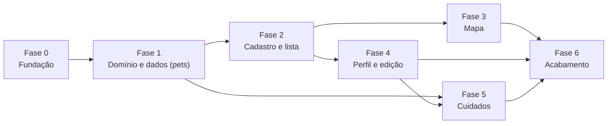

# 08 · Plano de desenvolvimento

Detalha as 7 fases do [plano do projeto §14](plano-do-projeto.md#14-plano-de-desenvolvimento) em **tarefas executáveis**, na ordem TDD.

**Legenda de status:** ✅ feito · 🟡 feito, ainda não validado · ⬜ pendente
**Tamanho:** P (≤ 2 h) · M (meio dia) · G (1 dia ou mais)

---

## 0. Situação atual

| Entregável | Status | Observação |
|------------|:------:|------------|
| Plano do projeto, documentação e UML (`docs/`) | ✅ | Diagramas em Mermaid |
| README | ✅ | |
| Esqueleto: pastas, tema, `Result`/`Failure`, `AppDatabase` + migração 001, shell com 3 abas, tela Informações | ✅ | `flutter analyze` limpo; validado com Flutter 3.47 / Dart 3.13 |
| Domínio inicial: enums, `Pet`, `PetLocation`, `CareRecord` (sealed), `CareSummary`, interfaces de repositório | ✅ | Testado |
| Testes: unitários, de dados (SQLite em memória) e use cases | ✅ | 95 testes passando; cobertura de domain+data+core ≈ 94 % |
| Projeto Flutter de plataforma (`android/`, `ios/`) | ✅ | Gerado; permissões `INTERNET` e textos de câmera/galeria configurados |
| **Fase 1 — domínio e dados de `pets`** (T1-1…T1-7) | ✅ | Validador, filtros, mapper, datasource, repositório SQLite, use cases e DI |
| **Fase 2 — cadastro e lista** (T2-1…T2-7) | ✅ | Serviço de fotos, rótulos, `TriStateSelector`, `PetFormViewModel`, `PetListViewModel`, páginas de cadastro e lista; 161 testes, ViewModels ≈ 90 % |
| **Fase 3 — mapa** (T3-1…T3-7) | ✅ | Tiles OSM com atribuição, marcadores SVG, filtro, enquadramento sem GPS, toque → confirmação → cadastro, resumo do marcador, mini-mapa no cadastro, aviso offline; 209 testes |
| **Fase 4 — perfil e edição** (T4-1…T4-4) | ✅ | Perfil com seções A, B, C, E e F, edição que preserva o histórico, vacinação antirrábica, remoção com confirmação, foto trocada/removida com limpeza segura; lista e mapa abrem o perfil; 249 testes |
| **Fase 5 — cuidados e histórico** (T5-1…T5-7) | ✅ | Registros de alimentação, banho, medicamento e saúde (só acrescentam), migração 002, destaques da última alimentação/banho, histórico por tipo, resumo de saúde no perfil; 326 testes |
| **Fase 6 — informações e acabamento** | 🟡 | Tudo o que dá para verificar sem aparelho está pronto (acessibilidade medida, fluxo com reabertura do banco, atribuição do OSM com link, roteiro). Faltam emulador/aparelho, APK e slides |

> ✅ **Fases 0 a 5 concluídas** e **Fase 6 em grande parte** (ver o status abaixo). O que resta depende de um **emulador ou aparelho Android** (testar a interface de verdade, `integration_test`, APK e capturas de tela) e de decisões do grupo (T0-6 fluxo Git, T0-9 centro do mapa).

## 1. Visão geral das fases

Após a Fase 1, **Fase 2 (pets)**, **Fase 5 (cuidados — camadas domain/data)** e a base da **Fase 3 (mapa)** podem andar em paralelo por pessoas diferentes.

## 2. Ciclo de cada tarefa (TDD)

1. Criar a branch `feature/T<fase>-<n>-<nome>`.
2. **RED:** escrever o teste e vê-lo falhar pelo motivo certo.
3. **GREEN:** implementar o mínimo para passar.
4. **REFACTOR:** limpar, mantendo verde.
5. `flutter analyze` · `dart format .` · `flutter test`.
6. Atualizar doc/UML afetados; abrir PR com checklist ([guia](07-guia-de-contribuicao.md)).

---

## Fase 0 — Fundação

**Objetivo:** ambiente funcionando e esqueleto comprovado (compila, analisa, testa).

| ID | Tarefa | Tam. | Depende | Status | Pronto quando |
|----|--------|:----:|---------|:------:|----------------|
| T0-1 | Instalar Flutter + Android Studio/SDK; `flutter doctor` sem erros | M | — | 🟡 | `flutter doctor` verde para Android |
| T0-2 | Gerar plataformas: `flutter create --platforms=android,ios --org br.edu.mapadopet --project-name mapa_do_pet .` (manter `lib/`, `pubspec.yaml`, `analysis_options.yaml`; apagar `test/widget_test.dart` de exemplo) | P | T0-1 | ✅ | Pastas `android/` e `ios/` existem; `git diff` não alterou `lib/` |
| T0-3 | `flutter pub get`; `flutter pub outdated`; ajustar versões do `pubspec.yaml` | P | T0-2 | ✅ | Dependências resolvidas sem conflito |
| T0-4 | Validar o esqueleto: `flutter analyze` e `flutter test` | P | T0-3 | ✅ | 0 avisos; todos os testes verdes (corrigir o que falhar) |
| T0-5 | Permissões: `INTERNET` (Android release), `NSCameraUsageDescription`/`NSPhotoLibraryUsageDescription` (iOS); `applicationId` | P | T0-2 | 🟡 | App abre no emulador na aba Mapa |
| T0-6 | Repositório Git: `main`/`develop`, proteção de `main`, template de PR, `.gitignore` | P | — | ⬜ | Primeiro PR aprovado e mesclado |
| T0-7 | Estrutura, tema, `Result`/`Failure`, `AppDatabase`, shell, tela Informações | G | — | ✅ | Ver T0-4 |
| T0-8 | Teste de migração 001: banco em memória com `sqflite_common_ffi`; `CHECK`s e `CASCADE` ativos | M | T0-4 | ✅ | Teste prova que apagar `pets` remove `care_records` |
| T0-9 | Decidir pendências ([plano §17](plano-do-projeto.md#17-decisões-em-aberto-a-equipe-define)): centro do mapa, remover animal, etc. | P | — | ⬜ | Decisões registradas (ADR se mudar arquitetura) |

**Saída da fase:** `flutter run` abre o app com 3 abas; CI local (analyze + test) verde.

---

## Fase 1 — Domínio e dados de `pets`

**Objetivo:** salvar, ler, atualizar e apagar animais com regras validadas. **Sem UI nova.**

| ID | Tarefa (teste primeiro) | Tam. | Depende | Req. |
|----|-------------------------|:----:|---------|------|
| T1-1 ✅ | `PetValidator` + `ValidationFailure`: espécie, gestante×macho, ninhada 1–20, tamanho de textos | M | T0-4 | RN-01…04, RN-13 |
| T1-2 ✅ | `TextNormalizer` (sem acento/caixa) + `SpeciesFilter`, `TextSearchFilter`, `CompositePetFilter` | M | T0-4 | RF-02, RF-08 |
| T1-3 ✅ | `PetMapper`: `toMap`/`fromMap` com *round-trip* de todos os campos, datas ISO-8601 UTC | M | T0-4 | — |
| T1-4 ✅ | `PetLocalDataSource` (insert/update/delete/query) com SQLite em memória | M | T0-8, T1-3 | RNF-01 |
| T1-5 ✅ | `PetRepositoryImpl`: `Result`, `INSERT OR IGNORE` (idempotência), exceção → `StorageFailure`, id inexistente → `NotFoundFailure` | M | T1-4 | RN-09 |
| T1-6 ✅ | Use cases: `RegisterPet`, `UpdatePet` (atualiza `updatedAt`, não toca em cuidados), `DeletePet`, `GetPets(filter)` | M | T1-1, T1-5 | RF-05, RF-10, RF-16 |
| T1-7 ✅ | Registrar no composition root (`app_providers.dart`) | P | T1-6 | — |

**Saída:** cobertura ≥ 80 % em `pets/domain` e `pets/data`; teste prova que editar pet não altera `care_records` (RN-07).

---

## Fase 2 — Cadastro e lista

| ID | Tarefa | Tam. | Depende | Req. |
|----|--------|:----:|---------|------|
| T2-1 ✅ | `ImageStorageService` (Facade): escolher, copiar para `pet_photos/`, apagar, resolver caminho; testes com *fake* do seletor | M | T0-4 | RF-06 |
| T2-2 ✅ | Extensões `label` pt-BR dos enums (apresentação) | P | T0-4 | — |
| T2-3 ✅ | `TriStateSelector` (widget + teste) | M | T2-2 | RF-11 |
| T2-4 ✅ | `PetFormViewModel`: id gerado ao abrir, `isSaving`, erros por campo, `save()` idempotente | G | T1-6 | RN-09 |
| T2-5 ✅ | `PetRegistrationPage` em seções; Gestante oculto para macho; quantidade de filhotes condicional | G | T2-3, T2-4 | RF-05 |
| T2-6 ✅ | `PetListViewModel` + `PetListPage` + `PetCard` + `SpeciesFilterBar`; estados carregando/vazio/sem resultado/erro | G | T1-2, T1-6 | RF-08 |
| T2-7 ✅ | Rota de cadastro (provisória: botão **Cadastrar** na lista abre o formulário no centro padrão; em T3-4 passa a nascer do toque no mapa)  — antes: rota `/pet/new` (recebe coordenadas; na Fase 2 pode vir de ponto fixo de teste) | P | T2-5 | — |

**Saída:** é possível cadastrar (só espécie) e achar o animal na lista, inclusive após reiniciar.

---

## Fase 3 — Mapa

| ID | Tarefa | Tam. | Depende | Req. |
|----|--------|:----:|---------|------|
| T3-1 ✅ | `FlutterMap` com tiles OSM, `userAgentPackageName`, atribuição visível (texto sempre visível; o **link** para openstreetmap.org/copyright fica para a Fase 6, com `url_launcher`) | M | T0-5 | RNF-07 |
| T3-2 ✅ | `PetMarker` com SVG cão/gato + `Semantics` | M | T3-1 | RF-01 |
| T3-3 ✅ | `MapViewModel`: carregar pets, filtro de espécie, enquadramento (`LatLngBounds`) ou centro padrão | M | T1-6 | RF-01, RF-02 |
| T3-4 ✅ | Toque em área livre → `ConfirmRegisterSheet` → `/pet/new` com `LatLng` | M | T2-7 | RF-03 |
| T3-5 ✅ | Toque no marcador → `PetSummarySheet` (foto, nome, espécie, botão "Ver perfil" — **oculto até a T4-2**, quando o perfil existir) | M | T3-2 | RF-04 |
| T3-6 ✅ | Mini-mapa de ajuste do ponto no formulário | M | T3-1, T2-5 | RF-07 |
| T3-7 ✅ | Aviso de "sem internet" e recarga do mapa ao voltar do cadastro | P | T3-3 | — |

**Saída:** cadastro de ponta a ponta pelo mapa; marcador aparece ao salvar.

---

## Fase 4 — Perfil e edição

| ID | Tarefa | Tam. | Depende | Req. |
|----|--------|:----:|---------|------|
| T4-1 ✅ | `GetPetProfile` (pet + `CareSummary` vazio por enquanto; a Fase 5 passa a preenchê-lo) e `PetProfileViewModel` | M | T1-6 | RF-09 |
| T4-2 ✅ | `PetProfilePage`: seções A, B, C, E, F; `AdoptionBanner`; "Não informado" para ausentes | G | T4-1 | RF-09 |
| T4-3 ✅ | `PetEditPage` reutilizando o formulário (`PetFormView` compartilhado, com a seção "Informações médicas" só na edição); troca de foto (apaga a antiga só após sucesso) | G | T2-5 | RF-10, RF-11 |
| T4-4 ✅ | Remover animal: diálogo de confirmação, cascata e remoção da foto | M | T4-2 | RF-16 |

**Saída:** consultar, editar e remover; teste de integração de dados confirma que editar preserva histórico.

---

## Fase 5 — Cuidados e histórico

| ID | Tarefa (teste primeiro) | Tam. | Depende | Req. |
|----|-------------------------|:----:|---------|------|
| T5-1 ✅ | `CareRecordMapper` (Factory por `type`) com *round-trip* dos 4 subtipos | M | T1-3 | RF-12 |
| T5-2 ✅ | **Migração 002** (`care_records.description`, usada pelo registro de saúde) + `CareLocalDataSource`: inserção idempotente, `CHECK`s, ordenação por `occurred_at` | M | T0-8, T5-1 | RN-06, RN-09 |
| T5-3 ✅ | `CareRepositoryImpl` + registro no DI | M | T5-2 | — |
| T5-4 ✅ | `AddCareRecord` com relógio injetado: data futura (RN-05), medicamento sem nome (RN-06) | M | T5-3 | RN-05, RN-06 |
| T5-5 ✅ | `GetPetProfile` passa a ler os cuidados e calcular o `CareSummary` (sem um `GetCareSummary` separado: seria só um repasse) | M | T5-3, T4-1 | RF-13 |
| T5-6 ✅ | `CareViewModel` + `CareRecordFormSheet` (data, hora opcional, responsável, notas; campos por tipo) | G | T5-4 | RF-12 |
| T5-7 ✅ | `LastCareHighlight`, listas por tipo (mais recente primeiro), resumo de saúde na seção C | G | T5-5, T5-6 | RF-13, RF-14 |

**Saída:** critérios de aceite de cuidados do plano §15 atendidos.

---

## Fase 6 — Informações e acabamento

| ID | Tarefa | Tam. | Depende | Req. |
|----|--------|:----:|---------|------|
| T6-1 | Acessibilidade: fonte a 200 %, `Semantics`, alvos ≥ 48 dp; conferir contraste com ferramenta | M | F2–F5 | RNF-05 |
| T6-2 | `integration_test`: cadastrar → listar → registrar alimentação → reiniciar → conferir | G | F5 | RNF-01 |
| T6-3 | Cobertura ≥ 80 % (domain/data/viewmodels); `flutter analyze` limpo; remover `TODO`s resolvidos | M | F2–F5 | RNF-06 |
| T6-4 | Sincronizar docs/UML com o código final; capturas de tela no README | M | T6-3 | — |
| T6-5 | Build de release (APK), vídeo/roteiro de demonstração, slides | M | T6-2 | — |

**Saída:** todos os itens do [plano §15](plano-do-projeto.md#15-critérios-de-aceite-do-mvp) marcados.

**Status da Fase 6** (o que foi feito e o que depende de aparelho):

| Tarefa | Status | Observação |
|--------|:------:|------------|
| T6-1 Acessibilidade | ✅ | Fonte a 200 %, alvos ≥ 48 dp, rótulos e contraste **medidos por testes** (ver [05 §7](05-interface-e-design.md#7-verificação-de-acessibilidade-medida)). **Falta** testar com TalkBack/VoiceOver em aparelho. |
| T6-2 Fluxo completo | 🟡 | Feito como teste comum (`test/integration/app_flow_test.dart`): SQLite real em arquivo, cadastrar → listar → cuidados → editar → **fechar e reabrir o banco** → remover. **Falta** o `integration_test` em emulador/aparelho. |
| T6-3 Cobertura e análise | ✅ | 369 testes; `lib/` 94,7 % (domain+data 99,1 %, ViewModels 95,2 %, UI 92,8 %); `flutter analyze` limpo; único `TODO` é a decisão em aberto do centro do mapa. |
| T6-4 Documentação | 🟡 | Docs, UML e README sincronizados com o código. **Faltam** as capturas de tela do README (exigem emulador). |
| T6-5 Entrega | 🟡 | Roteiro e slides sugeridos em [10](10-roteiro-de-apresentacao.md). **Faltam** o APK de release (exige Android SDK), o vídeo/demonstração e os slides prontos. |

---

## 3. Divisão sugerida (equipe de até 4)

| Pessoa | Frente | Tarefas |
|--------|--------|---------|
| A | Fundação, dados e cuidados | F0, T1-3…T1-7, F5 (domain/data) |
| B | Cadastro, lista e perfil | F2, F4 |
| C | Mapa e design | F3, T6-1 |
| D | Qualidade e documentação | testes de integração, CI local, docs/UML, T6-2…T6-5 |

Regras: PRs pequenos (≤ 400 linhas), uma tarefa por PR, nunca dois PRs editando o mesmo arquivo ao mesmo tempo (combinar no grupo).

## 4. Acompanhamento

| Métrica | Meta |
|---------|------|
| Tarefas concluídas por fase | 100 % antes de abrir a próxima (exceto frentes paralelas) |
| Cobertura (domain/data/viewmodels) | ≥ 80 % |
| `flutter analyze` | 0 avisos |
| Requisitos Must verificados | 15 de 15 (RF-01…RF-15) |

## 5. Riscos e gatilhos

| Risco | Gatilho | Resposta |
|-------|---------|----------|
| Versões de pacotes incompatíveis | `pub get` falha (T0-3) | Rodar `flutter pub upgrade --major-versions`; ajustar API de `flutter_map` se mudou |
| Esqueleto com erros de compilação | T0-4 falha | Corrigir antes da Fase 1 (escrito sem compilador) |
| Atraso | Fase 3 ou 5 passa do previsto | Cortar *Could/Should* (cluster, compartilhar, remover registro) |
| Tiles OSM bloqueados | Mapa em branco com internet | Trocar `tileUrlTemplate` em `AppConstants` |
| Conflitos de merge | Dois PRs no mesmo arquivo | Dividir por feature; rebase frequente em `develop` |

## 6. Checklist de entrega acadêmica

- [ ] Documento de planejamento (`plano-do-projeto.md`) e documentação técnica (`docs/`)
- [ ] Diagramas UML exportados (PNG/PDF) a partir do Mermaid
- [ ] Código no repositório com histórico de commits legível
- [ ] App rodando (APK ou demonstração no emulador)
- [ ] Testes e relatório de cobertura
- [ ] Apresentação: problema → arquitetura → padrões de projeto → demo → aprendizados
