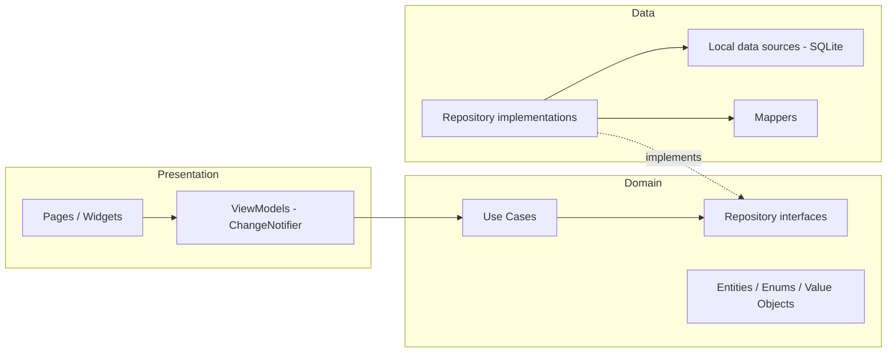
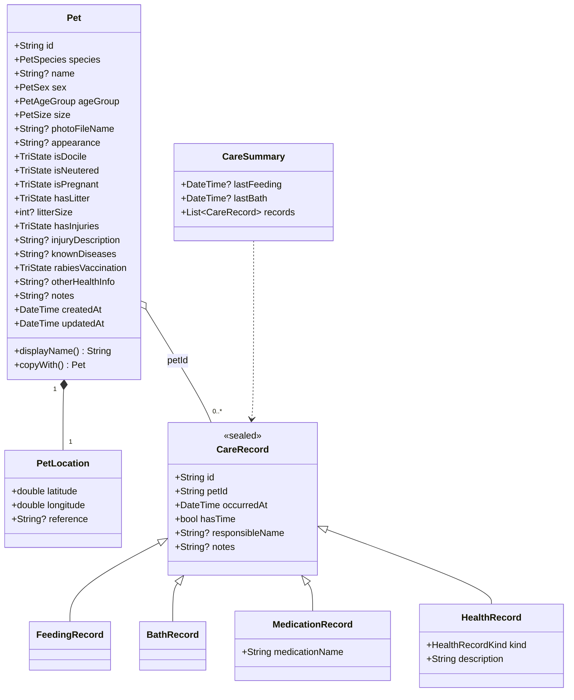
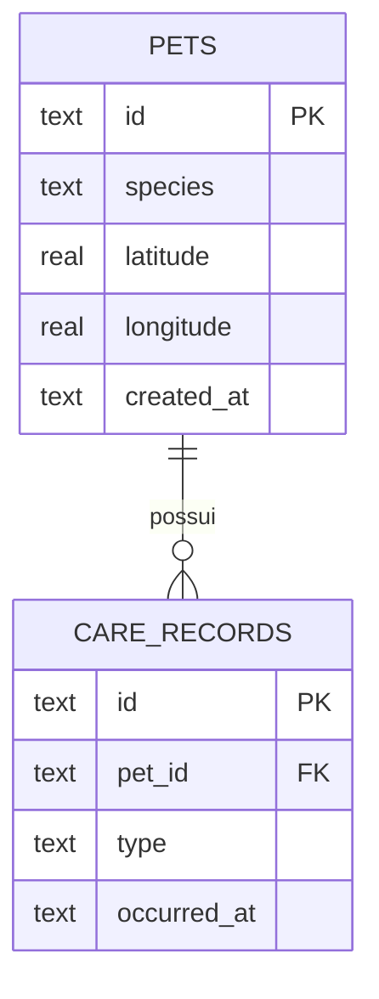

# Mapa do Pet — Plano do Projeto (versão revisada)

> Aplicativo mobile para cadastro, localização e acompanhamento de cães e gatos em situação de rua.
> **Stack:** Flutter · Dart 3 · SQLite · OpenStreetMap · Provider
> **Documento de planejamento — MVP v1.0**

---

## 1. Visão geral

### 1.1 Problema
Pessoas que cuidam de animais de rua (alimentam, dão banho, medicam) não têm um lugar simples para registrar **onde** o animal fica, **como** ele é e **o que já foi feito por ele**. A informação fica na memória de quem cuida, se perde e gera cuidados duplicados ou esquecidos.

### 1.2 Proposta
Um aplicativo que permite marcar o animal no mapa, manter um perfil com suas características e saúde, e registrar um **histórico imutável de cuidados** (alimentação, banho, medicamentos, saúde).

### 1.3 Objetivos
| ID | Objetivo |
|----|----------|
| O1 | Cadastrar cães e gatos a partir de um ponto tocado no mapa. |
| O2 | Consultar os animais em mapa e em lista (busca + filtros). |
| O3 | Manter perfil individual (características, localização aproximada, saúde). |
| O4 | Registrar cuidados preservando todo o histórico. |
| O5 | Permitir atualizar as informações quando novos detalhes forem descobertos. |
| O6 | Deixar a arquitetura pronta para, no futuro, ganhar backend/sincronização **sem reescrever o app**. |

### 1.4 Premissas do MVP
- Sem login, sem backend, sem sincronização. Dados em **SQLite local**.
- O app **nunca** solicita nem exibe a localização (GPS) do usuário.
- A localização do animal é **aproximada** e escolhida manualmente no mapa.
- Todos os animais cadastrados estão disponíveis para adoção (mensagem informativa fixa; não há status de adoção).
- **Colaboração no MVP:** como não há sincronização, a colaboração acontece no mesmo aparelho; o campo "responsável" identifica quem fez cada cuidado. A colaboração entre aparelhos é meta futura (O6), não do MVP.

---

## 2. Escopo (priorização MoSCoW)

| Prioridade | Itens |
|------------|-------|
| **Must** | Navegação (Mapa/Animais/Informações) · mapa com marcadores e filtro · cadastro por toque no mapa (só espécie obrigatória) · lista com busca e filtros · perfil · edição · vacinação antirrábica (3 estados) · registros de alimentação, banho, medicamento e saúde · última alimentação/banho calculadas · persistência local · tela de instruções |
| **Should** | Remover animal (com confirmação) · estados de carregamento/vazio/erro em todas as telas · acessibilidade (rótulos semânticos, alvos ≥ 48 dp) |
| **Could** | Agrupamento (cluster) de marcadores · compartilhar perfil como texto · corrigir/remover registro lançado por engano |
| **Won't (agora)** | Login · backend/sincronização · escala de voluntários · status/fluxo de adoção · rastreio da localização do voluntário · mapa offline |

---

## 3. Requisitos

### 3.1 Requisitos funcionais
| ID | Requisito | Prior. | Critério de aceite |
|----|-----------|--------|--------------------|
| RF-01 | Abrir direto na aba Mapa com marcadores dos animais. | Must | App abre no mapa; marcadores de cão e gato são distinguíveis. |
| RF-02 | Filtrar o mapa por Todos / Cachorros / Gatos. | Must | Ao filtrar, só os marcadores da espécie aparecem. |
| RF-03 | Tocar em local livre do mapa inicia cadastro, **após confirmação** ("Cadastrar animal aqui?"). | Must | Coordenadas do toque chegam preenchidas no formulário. |
| RF-04 | Tocar em marcador abre resumo com atalho para o perfil. | Must | Resumo exibe foto, nome e espécie; botão leva ao perfil. |
| RF-05 | Cadastrar animal com **somente espécie obrigatória**. | Must | Salvar com apenas espécie funciona; sem espécie, é bloqueado com mensagem. |
| RF-06 | Anexar foto (câmera ou galeria), opcional. | Must | Foto persiste após reiniciar o app. |
| RF-07 | Ajustar o ponto no mapa antes de finalizar. | Must | Nova coordenada é a salva. |
| RF-08 | Listar animais com busca (nome/região) e filtro de espécie. | Must | Busca ignora acentos e maiúsculas. |
| RF-09 | Exibir perfil com identificação, características, saúde, cuidados e aviso de adoção. | Must | Todos os dados informados aparecem; ausentes são omitidos ou "Não informado". |
| RF-10 | Atualizar dados gerais do animal sem afetar o histórico. | Must | Após editar, todos os registros de cuidado continuam existindo. |
| RF-11 | Registrar vacinação antirrábica: Sim / Não / Desconhecido. | Must | Exatamente 3 estados; padrão Desconhecido. |
| RF-12 | Registrar alimentação, banho, medicamento e saúde (append-only). | Must | Novo registro não altera os anteriores. |
| RF-13 | Destacar data da última alimentação e do último banho. | Must | Valor = registro de maior `occurredAt`, mesmo se lançado fora de ordem. |
| RF-14 | Exibir histórico por tipo em listas simples (sem timeline). | Must | Lista ordenada do mais recente para o mais antigo. |
| RF-15 | Tela "Como funciona o app?" estática. | Must | Texto e frase final presentes; sem acesso a banco. |
| RF-16 | Remover animal e seus registros, com confirmação. | Should | Diálogo informa que a ação é irreversível; remoção em cascata. |

### 3.2 Requisitos não funcionais
| ID | Requisito |
|----|-----------|
| RNF-01 | **Persistência:** dados sobrevivem a fechar/reabrir o app e a atualizações (migrações versionadas). |
| RNF-02 | **Privacidade:** nenhuma permissão de localização; câmera/galeria só quando o usuário escolhe adicionar foto; nenhum dado pessoal além do nome do responsável (opcional). |
| RNF-03 | **Manutenibilidade:** UI não conhece SQLite; regras de negócio testáveis sem Flutter. |
| RNF-04 | **Desempenho:** lista e mapa fluidos com ≥ 500 animais; consultas indexadas. |
| RNF-05 | **Acessibilidade:** contraste mínimo WCAG AA onde possível, alvos de toque ≥ 48 dp, `Semantics` em marcadores e botões de ícone, suporte a fonte ampliada. |
| RNF-06 | **Qualidade:** `flutter analyze` sem avisos; cobertura ≥ 80 % em domínio, dados e viewmodels. |
| RNF-07 | **Conformidade OSM:** atribuição visível e `User-Agent` identificando o app (política de uso de tiles). |

### 3.3 Regras de negócio
| ID | Regra |
|----|-------|
| RN-01 | Espécie é o único campo obrigatório do animal. |
| RN-02 | Gestante só pode ser "Sim" se o sexo não for macho (UI oculta o campo para machos). |
| RN-03 | Quantidade de filhotes só existe se "Possui ninhada" = Sim; valor entre 1 e 20. |
| RN-04 | Latitude ∈ [-90, 90] e longitude ∈ [-180, 180]. |
| RN-05 | Data de um cuidado não pode estar no futuro. |
| RN-06 | Medicamento exige o nome do medicamento. |
| RN-07 | Registros de cuidado são **append-only**: editar o animal nunca toca em `care_records`. |
| RN-08 | "Última alimentação/banho" = `max(occurredAt)` do tipo; nunca assume "hoje". |
| RN-09 | Salvar é **idempotente**: o `id` do registro é gerado ao abrir o formulário; toques repetidos não duplicam. |
| RN-10 | Nome de exibição: `name` ou, se vazio, "Cachorro sem nome" / "Gato sem nome". |
| RN-11 | O status de raiva do animal é um campo declarado e **independente** dos registros de saúde (uma vacina lançada no histórico não altera o campo automaticamente). |
| RN-12 | Medicamento registrado = o que foi administrado e quando; **não** é prescrição nem diagnóstico. |
| RN-13 | Limites de texto: nome ≤ 60; demais campos de texto ≤ 1000 caracteres. |

---

## 4. Identidade visual

| Cor | Hex | Papel no `ColorScheme` |
|-----|-----|------------------------|
| Caramelo | `#B97942` | `primary` — botões, seleção, destaques |
| Areia | `#E7C49F` | `secondaryContainer` / `surfaceContainer` — cartões, apoio |
| Branco | `#FFFDF9` | `surface` / `background` — fundo e leitura |
| Marrom | `#49382D` | `onSurface` / `onSecondaryContainer` — texto e ícones |

**Pontos de atenção (verificar com ferramenta de contraste antes de fechar o tema):**
- Texto branco sobre Caramelo e texto Marrom sobre Caramelo ficam em torno de **3:1–3,5:1**: passam apenas como *texto grande/negrito (≥ 14 pt bold ou 18 pt)* e componentes de UI. Portanto: rótulos de botão em negrito ≥ 16 sp; **não** usar Caramelo como cor de texto corrido.
- Marrom sobre Branco (~10:1) e Marrom sobre Areia (~6,8:1) são confortáveis para texto.
- O Material 3 exige papéis extras (`error`, `outline`, `surfaceVariant`…). Eles serão **derivados** das 4 cores (tons/opacidades) em `app_colors.dart`, sem introduzir novas cores de marca; o vermelho de erro será o único acréscimo funcional e deve ser documentado como exceção.
- Cão × gato não pode depender só de cor: marcadores usam **formas diferentes** (ver 5.1).

---

## 5. Navegação e telas

Barra inferior com `IndexedStack` (preserva zoom/posição do mapa ao trocar de aba): **Mapa · Animais · Informações**. Rotas centralizadas em `AppRouter.onGenerateRoute`.

### 5.1 Mapa
- Centro inicial **sem GPS**: enquadrar os animais cadastrados (`LatLngBounds`); se não houver nenhum, usar `AppConstants.defaultMapCenter` (cidade da instituição/equipe) com zoom padrão. *(lacuna do planner original: não definia onde o mapa abre.)*
- Marcadores: `assets/markers/dog.svg` e `cat.svg` (o Material Icons só tem um `pets`). Cão = silhueta/patinha preenchida em Caramelo; gato = forma distinta (orelhas) preenchida em Marrom.
- Toque em local livre → *bottom sheet* "Cadastrar animal aqui?" → formulário. A confirmação evita cadastros acidentais.
- Rodapé com atribuição "© OpenStreetMap contributors". Sem internet, os tiles não carregam: exibir aviso discreto, mas lista e perfis continuam funcionando.

### 5.2 Cadastro (formulário em seções)
Identificação · Características e observações · Localização (mini-mapa para ajustar o ponto + referência textual) · botão **Finalizar cadastro** (desabilitado enquanto salva, RN-09).
Campos tri-estado (Dócil, Castrado, Gestante, Ninhada, Ferimentos) usam um mesmo componente `TriStateSelector`.

### 5.3 Lista de animais
Busca (nome/referência de local), filtro de espécie (`SegmentedButton`), cartões com foto, nome de exibição, espécie, sexo, idade e região. Estados: carregando, vazio ("Nenhum animal cadastrado — toque no mapa para começar"), sem resultados, erro.

### 5.4 Perfil (tela única rolável)
A) Identificação · B) Características · C) Informações médicas (antirrábica, doenças, outras infos, **resumo somente-leitura** dos registros de saúde) · D) Cuidados (destaque: última alimentação e último banho; listas por tipo; botão "Adicionar registro") · E) Mensagem de adoção · F) Botão **Atualizar informações**.
> Correção do original: "histórico de atendimentos" aparecia em C e D. Agora há **uma única fonte** (`HealthRecord`), registrada em D e apenas *resumida* em C.

### 5.5 Informações
Tela estática "Como funciona o app?" com o texto do planner original, encerrando com "Adote um pet, mude uma vida!".

---

## 6. Arquitetura

**Clean Architecture enxuta + MVVM**, organizada **por funcionalidade (feature-first)** e, dentro de cada uma, por camada. A regra de dependência aponta sempre para o domínio.



| Camada | Contém | Pode depender de |
|--------|--------|------------------|
| **Domain** | Entidades imutáveis, enums, value objects, interfaces de repositório, casos de uso, validações | Somente Dart puro (nada de Flutter/sqflite) |
| **Data** | Implementações de repositório, data sources SQLite, mappers, serviços de arquivo/imagem | Domain |
| **Presentation** | Páginas, widgets, ViewModels | Domain (nunca Data) |
| **Core** | Tema, constantes, `Result`, utilitários, widgets compartilhados, composição (DI) | — |

**Por que isto e não o proposto originalmente (pastas `models/ repositories/ services/ viewmodels/ screens/ widgets/`)?**
Agrupar por tipo faz cada funcionalidade ficar espalhada em 6 pastas e não impõe a regra de dependência: nada impede uma tela de importar o SQLite. Feature-first + interfaces no domínio torna a regra verificável (a camada domain não importa `package:flutter`/`sqflite`) e simplifica a divisão do trabalho em equipe.

---

## 7. Padrões de projeto adotados

| Padrão | Onde aplicar | Por quê |
|--------|--------------|---------|
| **Repository** | `PetRepository`, `CareRepository` (interface em *domain*, implementação em *data*) | Isola a UI do SQLite; permite *fakes* nos testes e trocar por API no futuro (O6). |
| **MVVM + Observer** | `ChangeNotifier` + `Provider` (`Consumer`/`Selector`) | Estado de tela fora dos widgets; a UI reage a notificações. |
| **Dependency Injection** (por construtor) + *Composition Root* | `core/di/app_providers.dart` monta tudo no `main()` com `MultiProvider` | Dependências explícitas e substituíveis; sem estáticos escondidos. |
| **Singleton** | `AppDatabase` — uma única conexão SQLite | Evita múltiplas conexões/travas; é criado **uma vez** no composition root e injetado (não acessado globalmente). |
| **Factory Method** | `CareRecord.fromMap` (decide o subtipo por `type`), `PetSpecies.fromName` | Centraliza criação polimórfica e *parsing* seguro. |
| **Data Mapper / Adapter** | `PetMapper`, `CareRecordMapper` (entidade ⇄ `Map` do SQLite) | Domínio não conhece colunas nem formato de data. |
| **Strategy / Specification** | `PetFilter` (`SpeciesFilter`, `TextSearchFilter`, `CompositePetFilter`) | Filtros combináveis e testáveis, reutilizados por mapa e lista. |
| **Facade** | `ImageStorageService` (esconde `image_picker`, `path_provider`, cópia/remoção de arquivo) | Uma API simples para foto; UI não conhece plugins. |
| **Value Object** | `PetLocation` (valida RN-04, igualdade por valor) | Garante coordenadas válidas por construção. |
| **Null Object** | `unknown` em enums e `TriState.unknown` | Elimina `null` espalhado e ramificações na UI. |
| **Polimorfismo / herança** (sealed class) | `CareRecord` → `FeedingRecord`, `BathRecord`, `MedicationRecord`, `HealthRecord` | `switch` exaustivo verificado pelo compilador; demonstra OO real. |
| **Use Case (Interactor)** | `RegisterPet`, `UpdatePet`, `DeletePet`, `GetPets`, `GetPetProfile`, `AddCareRecord` | Regras de negócio num só lugar; ViewModels ficam finos. |
| **Result type** | `Result<T> = Ok \| Err` (sealed; `Err` carrega um `Failure`) | Tratamento de erro explícito, sem exceções cruzando camadas. |

**Considerados e não adotados (decisão consciente):** Bloc/Riverpod (Provider basta para 3 ViewModels), `get_it` (Provider já faz DI), Builder (`copyWith` resolve), geração de código com `freezed` (menos magia para fins didáticos), Abstract Factory (sem famílias de objetos).

---

## 8. Modelagem do domínio



### 8.1 Enums (valores em `lowerCamelCase`, convenção do Dart)
| Enum | Valores |
|------|---------|
| `PetSpecies` | `dog`, `cat` |
| `PetSex` | `male`, `female`, `unknown` |
| `PetAgeGroup` | `puppy`, `young`, `adult`, `senior`, `unknown` |
| `PetSize` | `small`, `medium`, `large`, `unknown` |
| **`TriState`** | `yes`, `no`, `unknown` |
| `HealthRecordKind` | `consultation`, `procedure`, `vaccine`, `injuryTreatment`, `general` |

**Melhoria:** o original criava `VaccinationStatus` e, separadamente, tratava Dócil/Castrado/Gestante/Ninhada/Ferimentos como "sim/não/desconhecido". São o mesmo conceito → **um único `TriState`** (DRY). Nomes de exibição em português ficam em extensões na camada de apresentação (o domínio não conhece idioma). Persistir o **nome** do enum (`'dog'`), nunca o índice, para sobreviver a reordenações.

### 8.2 Imutabilidade
Entidades com campos `final`, construtor `const` quando possível e `copyWith`; igualdade por valor (`==`/`hashCode`). Listas expostas como `List.unmodifiable`.

### 8.3 Exemplo de contratos (ilustrativo)
```dart
sealed class CareRecord {
  const CareRecord({required this.id, required this.petId,
      required this.occurredAt, this.hasTime = false,
      this.responsibleName, this.notes});
  final String id, petId;
  final DateTime occurredAt;
  final bool hasTime;
  final String? responsibleName, notes;
}

abstract interface class CareRepository {
  Future<Result<void>> add(CareRecord record);          // idempotente por id
  Future<Result<List<CareRecord>>> listByPet(String petId);
}
```

---

## 9. Persistência (SQLite)

### 9.1 Decisão de modelagem
Um único `care_records` com coluna `type` (*single-table inheritance*), em vez de 4 tabelas quase idênticas: uma consulta traz todo o histórico, menos código repetido e o domínio continua polimórfico via `sealed class`. Colunas específicas (`medication_name`, `health_kind`) são anuláveis e protegidas por `CHECK`.



### 9.2 Esquema
```sql
CREATE TABLE pets (
  id                 TEXT PRIMARY KEY,                       -- UUID v4
  species            TEXT NOT NULL CHECK (species IN ('dog','cat')),
  name               TEXT,
  sex                TEXT NOT NULL DEFAULT 'unknown' CHECK (sex IN ('male','female','unknown')),
  age_group          TEXT NOT NULL DEFAULT 'unknown' CHECK (age_group IN ('puppy','young','adult','senior','unknown')),
  size               TEXT NOT NULL DEFAULT 'unknown' CHECK (size IN ('small','medium','large','unknown')),
  photo_file_name    TEXT,                                   -- só o nome do arquivo
  appearance         TEXT,
  is_docile          TEXT NOT NULL DEFAULT 'unknown' CHECK (is_docile IN ('yes','no','unknown')),
  is_neutered        TEXT NOT NULL DEFAULT 'unknown' CHECK (is_neutered IN ('yes','no','unknown')),
  is_pregnant        TEXT NOT NULL DEFAULT 'unknown' CHECK (is_pregnant IN ('yes','no','unknown')),
  has_litter         TEXT NOT NULL DEFAULT 'unknown' CHECK (has_litter IN ('yes','no','unknown')),
  litter_size        INTEGER CHECK (litter_size IS NULL OR litter_size BETWEEN 1 AND 20),
  has_injuries       TEXT NOT NULL DEFAULT 'unknown' CHECK (has_injuries IN ('yes','no','unknown')),
  injury_description TEXT,
  known_diseases     TEXT,
  rabies_vaccination TEXT NOT NULL DEFAULT 'unknown' CHECK (rabies_vaccination IN ('yes','no','unknown')),
  other_health_info  TEXT,
  notes              TEXT,
  latitude           REAL NOT NULL CHECK (latitude  BETWEEN  -90 AND  90),
  longitude          REAL NOT NULL CHECK (longitude BETWEEN -180 AND 180),
  location_reference TEXT,
  created_at         TEXT NOT NULL,                          -- ISO-8601 UTC
  updated_at         TEXT NOT NULL
);

CREATE TABLE care_records (
  id               TEXT PRIMARY KEY,                         -- gerado ao abrir o formulário (RN-09)
  pet_id           TEXT NOT NULL REFERENCES pets(id) ON DELETE CASCADE,
  type             TEXT NOT NULL CHECK (type IN ('feeding','bath','medication','health')),
  occurred_at      TEXT NOT NULL,
  has_time         INTEGER NOT NULL DEFAULT 0,
  responsible_name TEXT,
  notes            TEXT,
  medication_name  TEXT,
  health_kind      TEXT,
  created_at       TEXT NOT NULL,
  CHECK (type <> 'medication' OR medication_name IS NOT NULL),
  CHECK (type <> 'health'     OR health_kind     IS NOT NULL)
);

CREATE INDEX idx_care_pet_type_date ON care_records (pet_id, type, occurred_at DESC);
CREATE INDEX idx_pets_species       ON pets (species);
```

### 9.3 Detalhes que evitam bugs reais
- `PRAGMA foreign_keys = ON` em `onConfigure` (o SQLite **não** ativa chaves estrangeiras por padrão — sem isso o `ON DELETE CASCADE` não funciona).
- **Migrações:** `version` no `openDatabase` + lista ordenada de migrações em `core/database/migrations/` (`onCreate` aplica todas; `onUpgrade` aplica as faltantes).
- **Fotos:** `ImageStorageService` copia a imagem escolhida para o diretório de documentos do app e guarda **apenas o nome do arquivo**; o caminho completo é resolvido em tempo de execução (no iOS o caminho absoluto muda entre atualizações). Ao remover/trocar a foto, apagar o arquivo antigo.
- **Datas:** salvar em ISO-8601 UTC; converter para local só na apresentação (`intl`, `pt_BR`).
- **Busca sem acento:** `LIKE` do SQLite ignora maiúsculas apenas para ASCII; como o volume é local e pequeno, a busca é feita em Dart sobre texto normalizado (`TextSearchFilter`).
- **Idempotência:** `insert(..., conflictAlgorithm: ConflictAlgorithm.ignore)` + botão desabilitado durante o salvamento.
- **Erros de I/O:** o repositório captura exceções e devolve `Failure` com mensagem amigável; o detalhe técnico vai para o log, não para o usuário.

---

## 10. Estrutura de pastas

```
lib/
├── main.dart                       # só inicializa e chama runApp
├── app.dart                        # MaterialApp, tema, rotas
├── core/
│   ├── di/app_providers.dart       # composition root (MultiProvider)
│   ├── database/
│   │   ├── app_database.dart       # conexão única + onConfigure
│   │   └── migrations/             # migration_001_initial.dart ...
│   ├── error/{result.dart, failure.dart}
│   ├── theme/{app_colors.dart, app_theme.dart}
│   ├── constants/app_constants.dart   # centro padrão do mapa, URL de tiles, limites
│   ├── services/{image_storage_service.dart, image_picker_gateway.dart}
│   ├── state/view_state.dart
│   ├── utils/{date_formatter.dart, text_normalizer.dart}
│   └── widgets/{empty_state.dart, error_view.dart, loading_view.dart}
├── features/
│   ├── pets/
│   │   ├── domain/
│   │   │   ├── entities/{pet.dart, pet_location.dart}
│   │   │   ├── enums/{pet_species, pet_sex, pet_age_group, pet_size, tri_state}.dart
│   │   │   ├── filters/pet_filter.dart      # PetFilter + SpeciesFilter + TextSearchFilter + CompositePetFilter
│   │   │   ├── validators/pet_validator.dart
│   │   │   ├── repositories/pet_repository.dart
│   │   │   └── usecases/{register_pet, update_pet, delete_pet, get_pets, get_pet_profile}.dart
│   │   ├── data/
│   │   │   ├── datasources/pet_local_datasource.dart
│   │   │   ├── mappers/pet_mapper.dart
│   │   │   └── repositories/pet_repository_impl.dart
│   │   └── presentation/
│   │       ├── viewmodels/{pet_list_viewmodel, pet_form_viewmodel, pet_profile_viewmodel}.dart
│   │       ├── pages/{pet_list_page, pet_registration_page, pet_profile_page, pet_edit_page}.dart
│   │       └── widgets/{pet_card, tri_state_selector, pet_form_sections, adoption_banner}.dart
│   ├── care/
│   │   ├── domain/{entities/care_record.dart, entities/care_summary.dart, enums/health_record_kind.dart,
│   │   │          repositories/care_repository.dart, usecases/add_care_record.dart}
│   │   ├── data/{datasources, mappers/care_record_mapper.dart, repositories/care_repository_impl.dart}
│   │   └── presentation/{viewmodels/care_viewmodel.dart, widgets/{care_section, last_care_highlight, care_record_tile, care_record_form_sheet}.dart}
│   ├── map/
│   │   └── presentation/{viewmodels/map_viewmodel.dart, pages/map_page.dart,
│   │                    widgets/{pet_marker, pet_summary_sheet, confirm_register_sheet, osm_attribution}.dart}
│   ├── info/presentation/pages/information_page.dart
│   └── shell/presentation/{home_shell.dart, app_bottom_navigation.dart}
assets/markers/{dog.svg, cat.svg}
test/                               # espelha lib/ (ver seção 12)
integration_test/
docs/
```

Cada arquivo deve ter responsabilidade única e, em regra, ≤ 300 linhas (limite rígido 800).

---

## 11. Dependências

| Pacote | Finalidade |
|--------|-----------|
| `flutter_map`, `latlong2` | Mapa com tiles OSM e coordenadas |
| `provider` | Estado (ViewModels) e injeção de dependência |
| `sqflite`, `path`, `path_provider` | SQLite e diretórios do app |
| `image_picker` | Câmera/galeria |
| `uuid` | Identificadores gerados no cliente (idempotência) |
| `intl` | Datas e textos em pt-BR |
| `flutter_svg` | Marcadores de cão e gato |
| *dev:* `flutter_lints`, `mocktail`, `sqflite_common_ffi`, `integration_test` | Análise estática, mocks, SQLite em memória nos testes, testes de fluxo |
| *opcional (Could):* `flutter_map_marker_cluster`, `share_plus` | Cluster de marcadores e compartilhar perfil |

Antes de fixar versões, conferir compatibilidade no pub.dev (`flutter pub outdated`). Checklist de plataforma: permissão `INTERNET` no `AndroidManifest.xml` de release (tiles) e textos `NSCameraUsageDescription` / `NSPhotoLibraryUsageDescription` no `Info.plist`.

---

## 12. Estratégia de testes (TDD)

Para cada caso de uso/ViewModel: **teste primeiro (RED) → implementação mínima (GREEN) → refatorar**.

| Nível | O que cobre | Ferramentas |
|-------|-------------|-------------|
| **Unitário (domínio)** | Entidades, `PetLocation`, `TriState`, filtros, `CareSummary` (última alimentação com lançamentos fora de ordem), validações RN-01…RN-06 | `flutter_test` |
| **Unitário (ViewModels/casos de uso)** | Estados loading/sucesso/erro, botão não duplica ao salvar 2× | `mocktail` com repositórios *fake* |
| **Integração de dados** | Repositórios contra SQLite **em memória**: CRUD, `CASCADE`, migrações, `CHECK`s | `sqflite_common_ffi` |
| **Widget** | Formulário (só espécie obrigatória), `TriStateSelector`, estados vazio/erro, `PetCard` | `flutter_test` |
| **Integração (fluxo)** | Cadastrar → aparece na lista → registrar alimentação → "última alimentação" correta → reiniciar → dados persistem | `integration_test` |

Meta: **≥ 80 %** de cobertura em domain + data + viewmodels (`flutter test --coverage`).

---

## 13. Qualidade, acessibilidade e segurança

**Qualidade de código** — `flutter_lints` + `analysis_options.yaml` estrito; `dart format`; nomes em `camelCase`/`PascalCase`; booleanos com `is/has/can`; sem números mágicos (constantes em `AppConstants`); sem `print` (usar logger simples); nenhum `!` desnecessário.

**Usabilidade** — formulários em seções, linguagem simples, apenas espécie marcada como obrigatória, confirmação para ações destrutivas, *feedback* (SnackBar) após salvar, estados de carregamento/vazio/erro em toda tela.

**Acessibilidade** — `Semantics`/`tooltip` em marcadores e botões de ícone, alvos ≥ 48 dp, teste com fonte ampliada, informação nunca só por cor.

**Segurança e privacidade** — sem permissão de localização; câmera/galeria sob demanda; validar toda entrada nos casos de uso (não confiar na UI); consultas SQLite **sempre parametrizadas** (`whereArgs`); sem dados pessoais além do nome opcional do responsável; sem segredos no repositório; manter dependências atualizadas.

---

## 14. Plano de desenvolvimento

Tamanho: P (pequeno) · M (médio) · G (grande). Cada fase só termina com *Definition of Done* atendida.

| Fase | Entregas | Tam. | Requisitos |
|------|----------|------|-----------|
| **0. Fundação** | Repositório Git e fluxo de branches; projeto Flutter; `analysis_options`; tema e `ColorScheme`; `Result`; esqueleto de pastas; `AppDatabase` + migração 001 (SQLite em memória nos testes); shell com navegação | M | RNF-03, RNF-06 |
| **1. Domínio e dados (pets)** | Entidades, enums, `PetLocation`, mappers, `PetRepository` (interface + impl), casos de uso, filtros — **tudo com testes primeiro** | M | RN-01…04, RF-05 |
| **2. Cadastro e lista** | Formulário por seções, `ImageStorageService`, lista com busca/filtros, estados vazio/erro | G | RF-05…08 |
| **3. Mapa** | Tiles OSM + atribuição, marcadores SVG, filtro, centro padrão, toque→confirmação→cadastro, resumo do marcador | G | RF-01…04, RNF-07 |
| **4. Perfil e edição** | Perfil completo, vacinação antirrábica, edição preservando histórico, remoção com confirmação | M | RF-09…11, RF-16 |
| **5. Cuidados** | `CareRecord` (sealed), repositório, `AddCareRecord`, `CareSummary`, formulários, destaques e listas por tipo | G | RF-12…14, RN-05…09 |
| **6. Informações e acabamento** | Tela estática, acessibilidade, revisão de contraste, testes de fluxo, README, documentação final | M | RF-15, RNF-05 |

**Definition of Done (por tarefa):** testes escritos e passando · `flutter analyze` limpo · código revisado por outro membro (PR) · sem `print`/segredos · requisito relacionado verificado.

**Fluxo Git:** `main` protegida · branches `feature/<id>-<nome>` · *Conventional Commits* (`feat:`, `fix:`, `test:`, `docs:`, `refactor:`) · PR com checklist. Após a Fase 1, a equipe pode dividir o trabalho por feature (`pets`, `care`, `map`) com baixo conflito de arquivos.

---

## 15. Critérios de aceite do MVP

- [ ] Cadastrar cão ou gato tocando no mapa (RF-03, RF-05)
- [ ] Cadastro exige somente a espécie (RN-01)
- [ ] Marcador aparece no mapa após o cadastro e é distinguível por espécie (RF-01)
- [ ] Animal aparece na lista e é encontrado por busca/filtro (RF-08)
- [ ] Perfil mostra os dados disponíveis (RF-09)
- [ ] Atualizar características, localização e condições médicas (RF-10)
- [ ] Antirrábica aceita Sim/Não/Desconhecido (RF-11)
- [ ] Registrar alimentação, banho, medicamento e saúde (RF-12)
- [ ] Perfil exibe corretamente a última alimentação e o último banho (RF-13, RN-08)
- [ ] Registros anteriores permanecem após novos registros e edições (RN-07)
- [ ] Dados permanecem após fechar e reabrir o app (RNF-01)
- [ ] Navegação entre Mapa, Animais e Informações funciona (RF-01, RF-15)
- [ ] O app nunca solicita nem exibe a localização do usuário (RNF-02)
- [ ] Salvar duas vezes seguidas não duplica registros (RN-09)
- [ ] `flutter analyze` limpo e cobertura ≥ 80 % (RNF-06)

---

## 16. Riscos

| Risco | Impacto | Mitigação |
|-------|---------|-----------|
| Política de uso dos tiles do OSM (servidor público não é para uso intenso) | Mapa bloqueado | Atribuição + `User-Agent`; URL do provedor isolada em `AppConstants` para trocar facilmente. |
| Sem internet o mapa fica sem tiles | Experiência ruim | Aviso discreto; lista/perfil seguem offline; mapa offline é *Won't* do MVP. |
| Caminho absoluto de fotos muda (iOS) | Fotos "somem" | Guardar só o nome do arquivo (9.3). |
| Activity do Android destruída ao abrir a câmera | Foto perdida | Tratar `retrieveLostData` do `image_picker`. |
| Escopo grande para o prazo | Atraso | MoSCoW: cortar *Should/Could* antes de *Must*; fases entregam valor incremental. |
| Contraste do Caramelo | Acessibilidade | Rótulos em negrito ≥ 16 sp, sem texto corrido em Caramelo (seção 4). |
| Privacidade da localização dos animais | Exposição de local sensível | Localização aproximada e armazenada só no aparelho; compartilhamento futuro deve ser opt-in. |

---

## 17. Decisões em aberto (a equipe define)

1. **Centro padrão do mapa:** qual cidade/instituição? (necessário para `AppConstants.defaultMapCenter`).
2. **Remover animal (RF-16):** manter como *Should* ou cortar? (o original previa "exclusão" no repositório, mas nenhuma tela).
3. **Corrigir registro de cuidado lançado por engano:** manter *append-only* puro (RN-07) ou permitir remoção do registro (Could)?
4. **Antirrábica × registro de vacina (RN-11):** manter independentes (padrão) ou sugerir atualizar o status ao lançar vacina?
5. **Nome do pacote/applicationId** (ex.: `br.edu.<instituicao>.mapadopet`).

---

## Apêndice A — O que mudou em relação ao planner original

| # | Problema no original | Melhoria |
|---|----------------------|----------|
| 1 | Pastas por tipo; nada impõe a separação UI × SQLite | Feature-first + Clean/MVVM, repositórios como **interfaces** no domínio |
| 2 | Padrões de projeto não citados | Seção 7 com 13 padrões, justificados e com "não adotados" |
| 3 | Sem camada de regras de negócio | Casos de uso + validações RN-01…13 |
| 4 | `VaccinationStatus` duplicava o "sim/não/desconhecido" de outros campos | Enum único `TriState` |
| 5 | Enums em `UPPER_CASE` (`DOG`) | `lowerCamelCase` (convenção Dart) e persistência por nome |
| 6 | 4 classes/tabelas de registro quase idênticas | `sealed class CareRecord` + tabela única com `type` |
| 7 | Sem esquema SQL, chaves, índices, migrações | Seção 9 completa (FK + `CASCADE`, `CHECK`, índices, versionamento) |
| 8 | Fotos sem estratégia de armazenamento | Cópia para o app + só nome do arquivo |
| 9 | Mapa sem ponto inicial definido (sem GPS) | Enquadrar animais ou centro padrão configurável |
| 10 | Toque no mapa cadastra direto (risco de acidente) | Confirmação em *bottom sheet* |
| 11 | Material Icons não distingue cão de gato; paleta de 4 cores | Marcadores SVG com formas distintas |
| 12 | Contraste do Caramelo não analisado; Material 3 pede mais papéis de cor | Seção 4: mapeamento de `ColorScheme` e regras de uso |
| 13 | Objetivo "colaboração" contradiz "sem sincronização" | Premissa reescrita (1.4) |
| 14 | "Atendimentos" duplicado em Médicas e Cuidados | Fonte única (`HealthRecord`) + resumo somente-leitura |
| 15 | Idempotência citada, sem mecanismo | UUID gerado ao abrir o formulário + `ConflictAlgorithm.ignore` |
| 16 | "Última alimentação" sem distinguir data do fato × data do lançamento | `occurredAt` (usa o maior valor) × `createdAt` |
| 17 | Testes só na última etapa | TDD em todas as fases, pirâmide de testes, meta de cobertura |
| 18 | Sem requisitos numerados/rastreáveis | RF/RNF/RN com critérios de aceite e vínculo às fases |
| 19 | Sem riscos, Definition of Done nem fluxo Git | Seções 14 e 16 |
| 20 | Exclusão no repositório sem tela correspondente | RF-16 (Should) e decisão em aberto |
