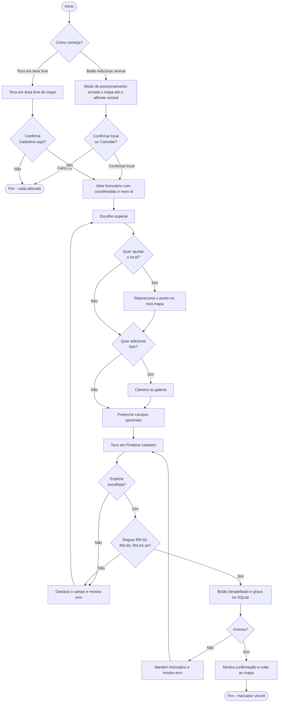
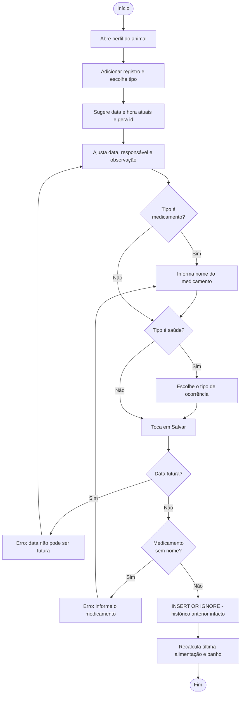
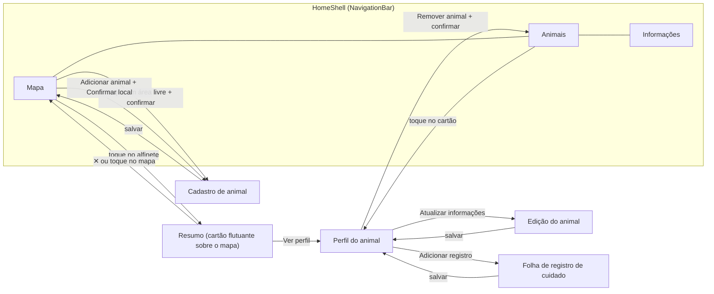
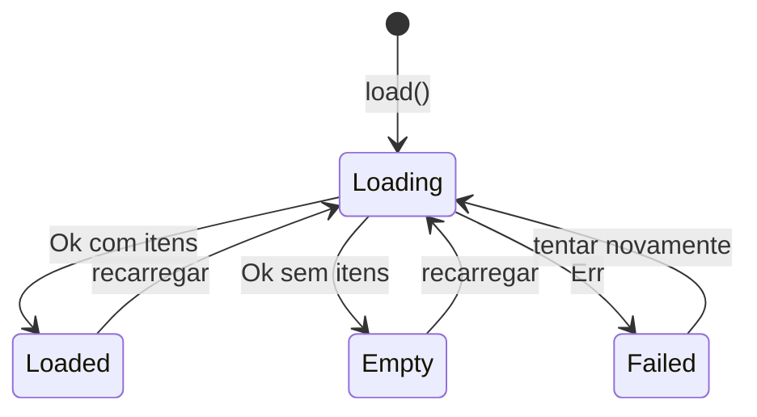
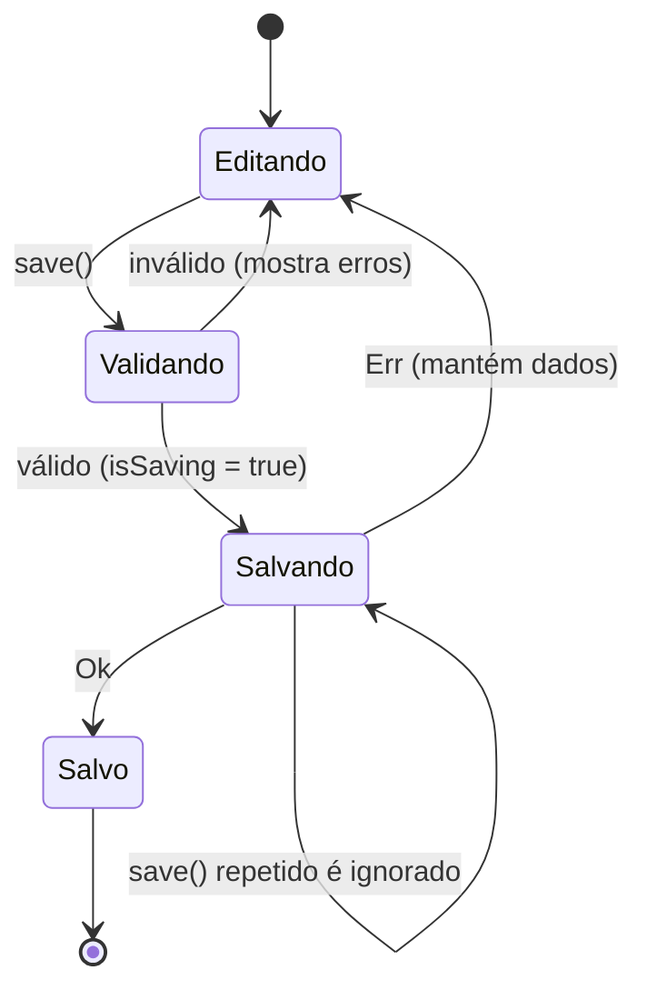
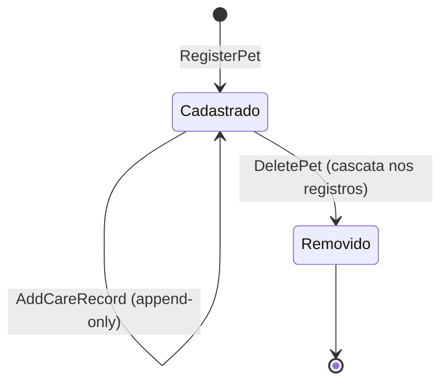

# UML · Atividades e estados

## 1. Diagrama de atividades — cadastrar animal

## 2. Diagrama de atividades — registrar cuidado

## 3. Navegação entre telas

## 4. Máquinas de estados

### 4.1 Estado de carregamento de uma tela (`ViewState`)

### 4.2 Salvamento de formulário (anti-duplicidade, RN-09)

### 4.3 Ciclo de vida de um animal

### 4.4 Modos da tela do mapa (`MapPage`)

```mermaid
stateDiagram-v2
  [*] --> Livre
  Livre --> Selecionado : toque no alfinete (câmera voa até o animal)
  Selecionado --> Selecionado : toque em outro alfinete
  Selecionado --> Livre : ✕ ou toque no mapa
  Selecionado --> Livre : Ver perfil (volta e recarrega)
  Livre --> Posicionando : botão Adicionar animal
  Posicionando --> Livre : Cancelar
  Posicionando --> Livre : Confirmar local (abre o cadastro; ao voltar recarrega)
  Livre --> Livre : toque em área livre → "Cadastrar animal aqui?"
```

No modo **Posicionando** o toque no mapa é ignorado (o mapa só é arrastado) e os botões de
zoom e o botão "Adicionar animal" ficam ocultos. Detalhes em
[05 §8](../05-interface-e-design.md#8-interações-do-mapa).

> Não existe estado "adotado": todos os animais são considerados disponíveis para adoção (plano §1.4).
