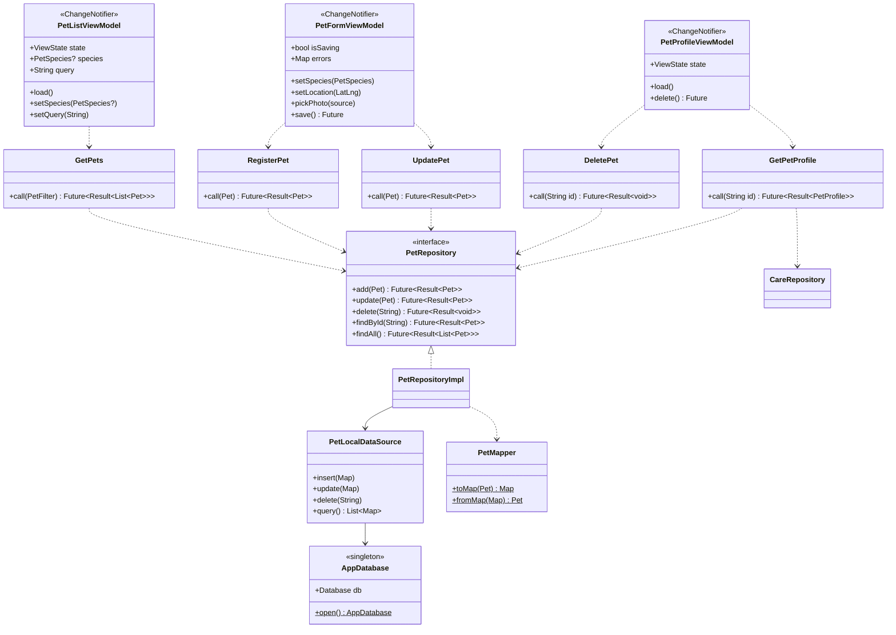
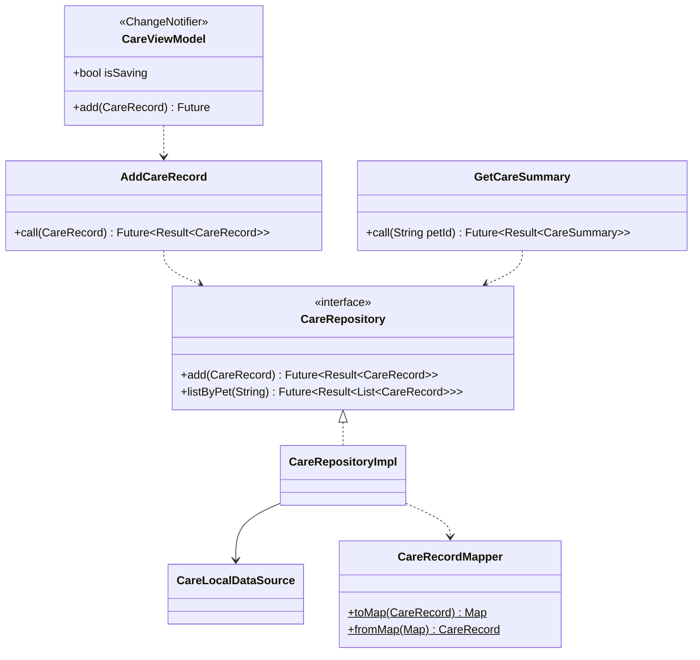
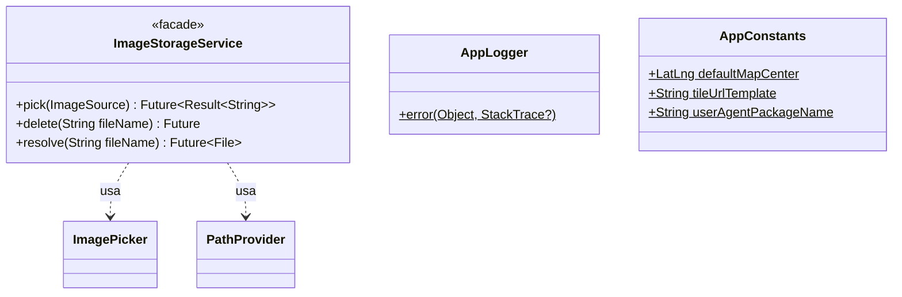

# UML · Diagrama de classes — Camadas

Mostra como casos de uso, repositórios, fontes de dados e ViewModels se ligam. Entidades: ver [classes-dominio.md](classes-dominio.md).

## 1. Feature `pets`

## 2. Feature `care`

> `CareRecordMapper.fromMap` é um **Factory Method**: lê a coluna `type` e devolve `FeedingRecord`, `BathRecord`, `MedicationRecord` ou `HealthRecord`.

## 3. Serviços compartilhados (`core`)

## 4. Regra de dependência (resumo)

| De → Para | Permitido? |
|-----------|:---------:|
| ViewModel → Use Case | ✅ |
| Use Case → Interface de repositório | ✅ |
| Repositório (impl) → Interface (domain) | ✅ |
| ViewModel → Repositório (impl) | ❌ |
| Domain → `sqflite` / `flutter` | ❌ |
| Page → `AppDatabase` | ❌ |
