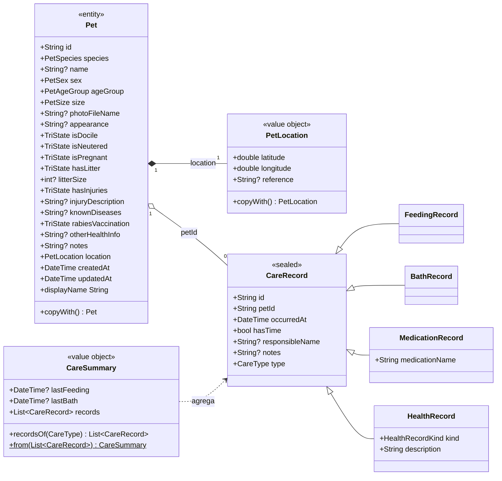
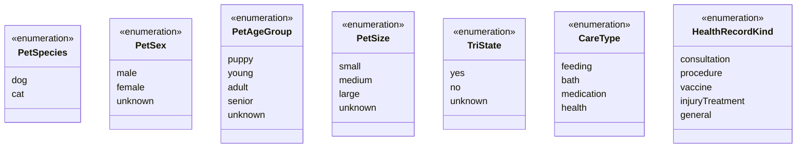
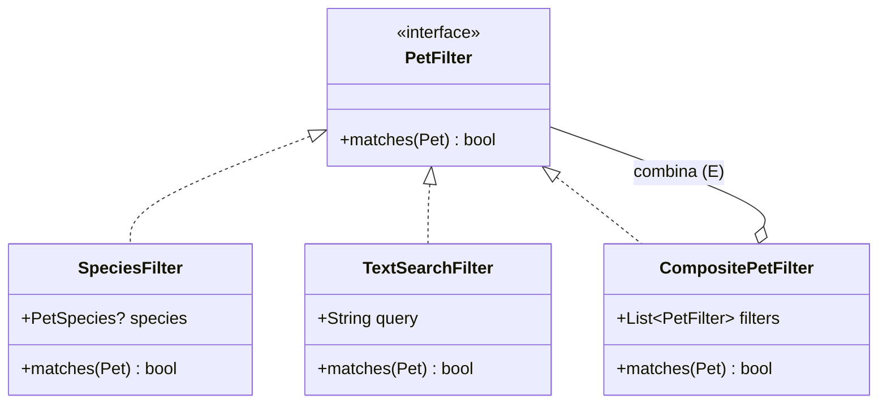
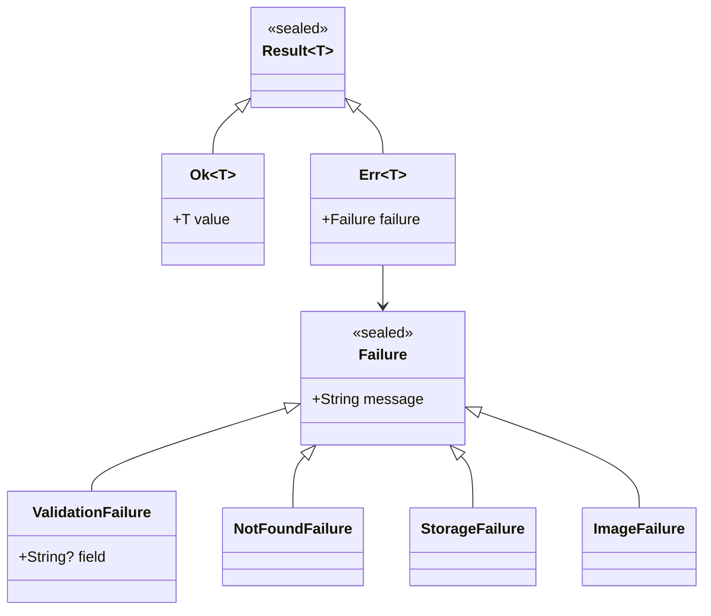

# UML · Diagrama de classes — Domínio

Camada `domain` (Dart puro). Convenções: `<<entity>>` entidade imutável · `<<value object>>` igualdade por valor · `<<enumeration>>` enum · `<<interface>>` contrato.

## 1. Entidades e value objects

## 2. Enumerações

> `TriState` é reutilizado por: `isDocile`, `isNeutered`, `isPregnant`, `hasLitter`, `hasInjuries`, `rabiesVaccination` (DRY — ver [plano §8.1](../plano-do-projeto.md#81-enums-valores-em-lowercamelcase-convenção-do-dart)).

## 3. Filtros (Strategy / Specification)

## 4. Resultado e falhas

## 5. Invariantes do domínio

| Invariante | Onde é garantida | Regra |
|------------|------------------|-------|
| Coordenadas válidas | Construtor de `PetLocation` (`assert`) + `RegisterPet` | RN-04 |
| Espécie presente | Tipo não anulável `PetSpecies` | RN-01 |
| Gestante ≠ sim para macho | `PetValidator` | RN-02 |
| `litterSize` só com ninhada = sim, 1–20 | `PetValidator` | RN-03 |
| Data do cuidado não futura | `AddCareRecord` (relógio injetado) | RN-05 |
| Medicamento com nome | `AddCareRecord` | RN-06 |
| Última alimentação/banho = maior `occurredAt` | `CareSummary.from` | RN-08 |
