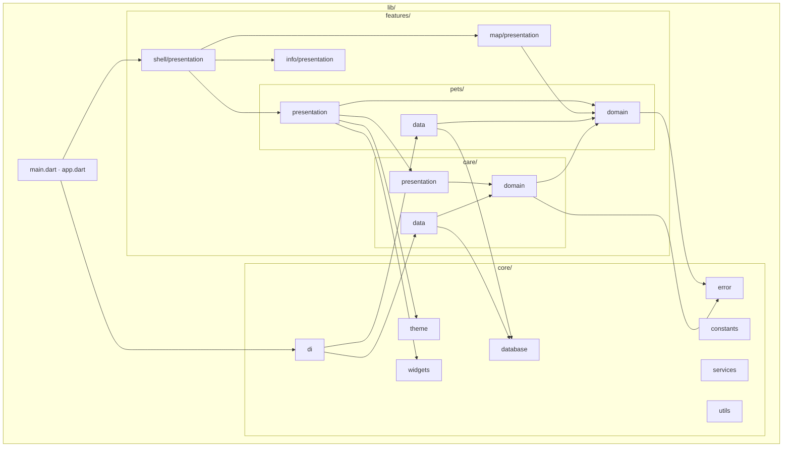
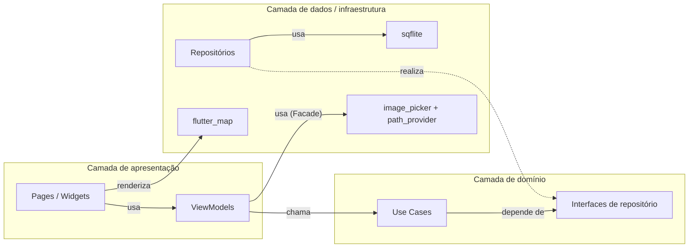
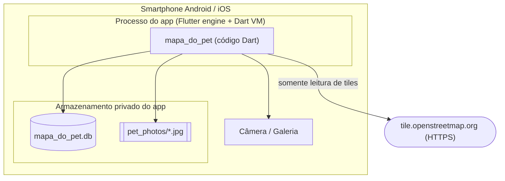

# UML · Componentes, pacotes e implantação

## 1. Diagrama de pacotes

Setas = "depende de". Nenhuma seta sai de `domain` para fora dele ou de `core/error`.

## 2. Diagrama de componentes

| Componente | Tipo | Provê | Requer |
|------------|------|-------|--------|
| `flutter_map` + `latlong2` | Biblioteca | Mapa interativo e coordenadas | Internet (tiles) |
| `sqflite` | Plugin nativo | Persistência SQLite | — |
| `image_picker` | Plugin nativo | Câmera/galeria | Permissões sob demanda |
| `path_provider` | Plugin nativo | Pasta de documentos | — |
| `provider` | Biblioteca | DI e observação de estado | — |
| `uuid` | Biblioteca | IDs | — |

## 3. Diagrama de implantação

Não há servidor próprio, banco remoto nem contas de usuário no MVP.
