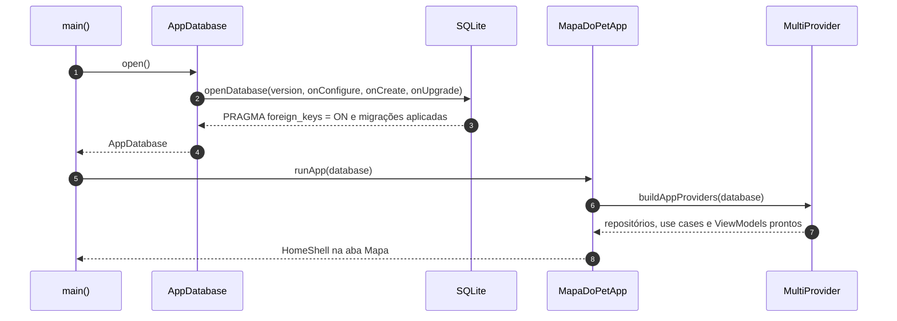
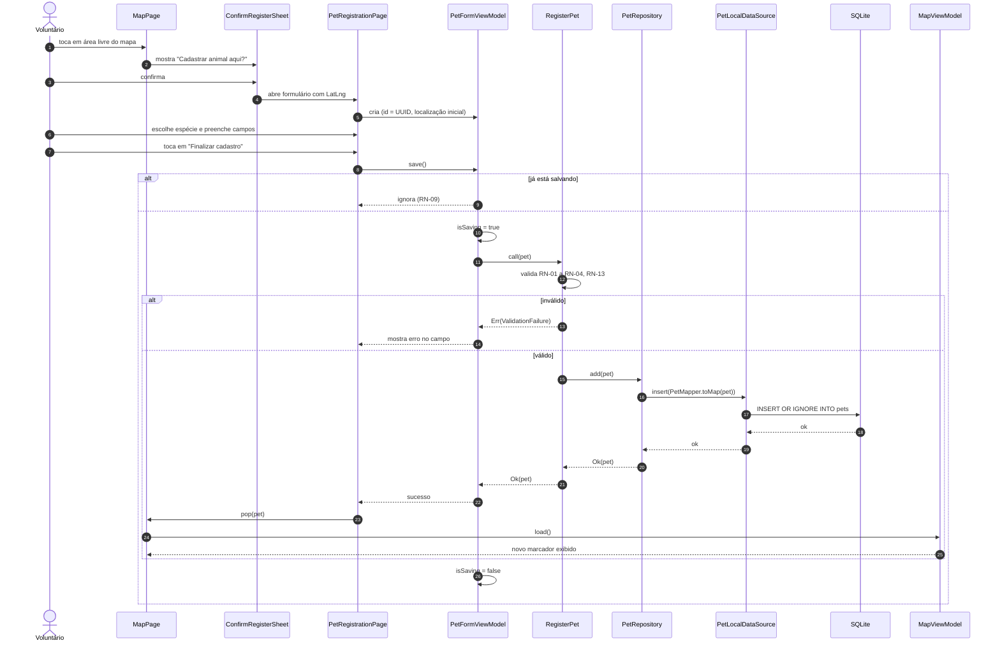
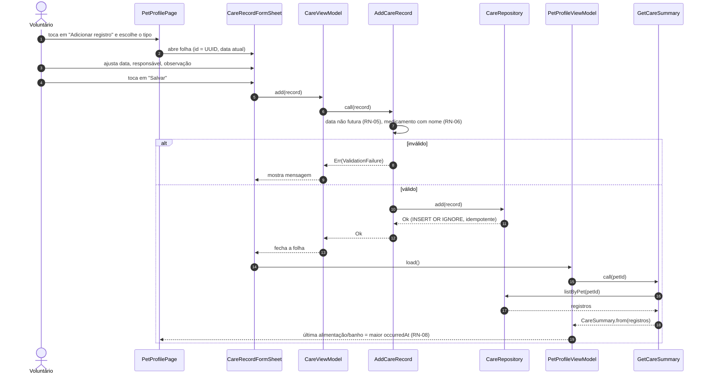
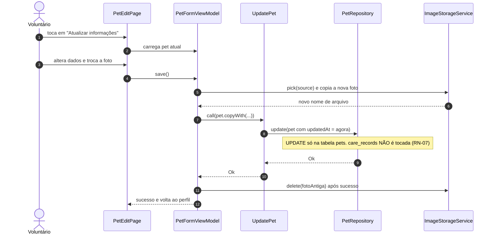
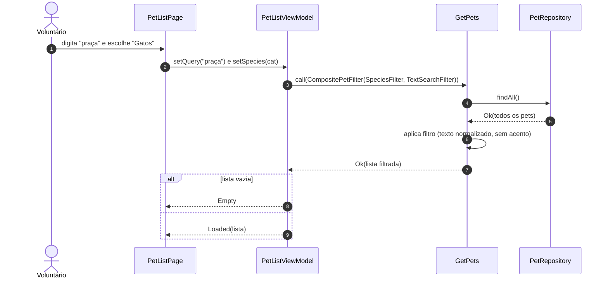
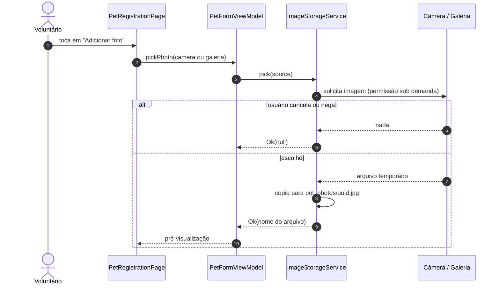

# UML · Diagramas de sequência

## 1. Inicialização do app

## 2. Cadastrar animal pelo mapa (UC-03)

## 3. Registrar cuidado e recalcular o destaque (UC-09)

## 4. Atualizar animal preservando o histórico (UC-08)

## 5. Buscar e filtrar na lista (UC-06)

## 6. Escolher foto

